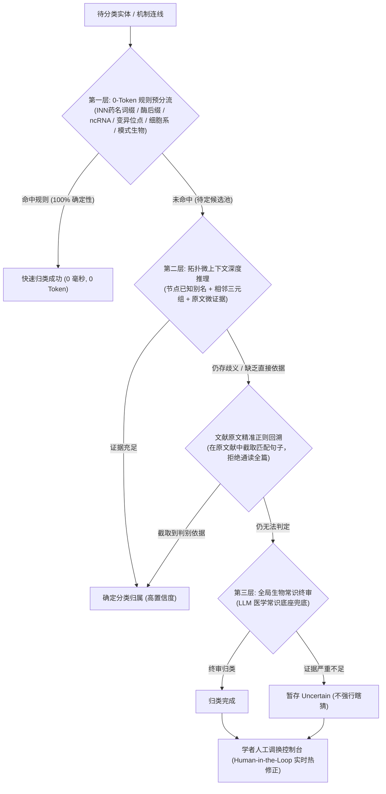

<p align="right">
   <a href="README_EN.md">English</a> &nbsp;｜&nbsp; <strong>中文</strong>
</p>

<div align="center">

# 🧬 Bio-Graph Agent

**跨文献增量生物知识图谱与多模态机制发现引擎 (v2.0 独立演进版)**

[](#)
[](https://www.python.org/)
[](#)
[](https://opensource.org/licenses/MIT)

</div>

本项目聚焦于生物医药与宏观生命科学领域长文本结构化抽取、顶刊机制通路多模态解析与科研假说落地诉求。依托现代长文本大语言模型（LLMs）卓越的上下文理解能力、多模态视觉转译与严谨推理性能，深度融合**图论拓扑分析、三层规则-大模型混合分类机制与调控回路挖掘算法**，构建了一套能够自文献（PDF）中自动提取、双层反思质检、前置机制图多模态转译、跨文献语义对齐、本体多阶研判、局部通路因果拆解，并最终生成高交互性动态网络拓扑图的 **Bio-Knowledge Graph LLM Agent**。

---

## 🎯 项目立项初衷与科学价值 (Why this project?)

在生物医学与生命科学科研领域，一个经典的重大痛点是：**如何在浩如烟海的文献中寻找极具科研价值的全新选题与因果调控假说？**

已知在生物系统中，“分子 A 调控 蛋白质 B”与“蛋白质 B 调控 生物表型/疾病表型 C”往往各自散落在不同年份、不同期刊的孤立论文中。而**证明“A 是通过 B 这一关键中间节点来介导并影响 C”的完整调控级联通路，往往就是一个极具学术价值、能够直接支撑一项重大课题或国家自然科学基金申报的核心选题。**

然而，依靠传统人工阅读去拼凑这种跨文献的长链级联关系，效率极低、极易遗漏，且容易受研究者主观认知盲区所限。

**Bio-Graph Agent** 正是为了攻克这一痛点而生。它作为科研人员的“智能选题军师”与“机制探索助手”：
1. **多模态图文并进**：不仅高效解析长篇复杂学术论文正文，更能前置嗅探并转译图文摘要 (Graphical Abstract) 与顶级期刊的矢量/复合信号通路机制图。
2. **打通知识孤岛**：通过跨文献语义实体对齐与权威在线 PMID 比对，将多篇不同论文里的基因、蛋白质、代谢物、细胞亚群、疾病表型及理化因子串联成网。
3. **三层本体精准研判**：通过 0-Token 规则预分流、微上下文推理与原文正则回溯，精确标定分子类别与深层机制动词（催化磷酸化、泛素化降解、转录激活等）。
4. **图论通路因果拆解**：运用图论中心度度量与大模型混合评分，自动拆解高内聚调控通路，深挖正负反馈自调控闭环，直观呈现 $A \to B \to C$ 的完整机制链路，并支持降级导出为独立子工程进行二次深度挖掘。

---

## 🎨 拓扑网络可视化视觉规范

本系统严格遵循国际生物医学与分子生物学标准调控规范进行视觉拓扑渲染：
* **🟢 绿色实线 + 箭头 ($\to$)**：代表 **正作用 / 激活 / 促进 / 上调 (Activation / Promotion / Positive Regulation)**。
* **🔴 红色实线 + 平头/箭头 ($\dashv$)**：代表 **负作用 / 抑制 / 阻断 / 降解 (Inhibition / Suppression / Negative Regulation)**。
* **⚪ 灰色实线 ($\sim$)**：代表 **一般关联 / 相互作用但极性未明 (Association / Binding / Interaction)**。
* **⚠️ 灰色虚线 ($---$)**：代表 **机制捷径边 (Shortcut Edge)**，跨越中间传导节点的宏观粗放结论，拆解通路中自动透明隔离。
* **🟣 紫色实线 ($\subset$)**：代表 **从属包含 / 复合体亚基 / 家族成员 (Hierarchy / Complex Subunit / Containment)**。
* **🔮 节点动态热度与形态映射**：
  - 主图谱中节点大小根据其跨文献全网连接度（度中心性）自适应缩放；
  - 分析工作台中按 NIH BioRED 权威标准映射为 10 种几何形态（圆点、菱形、正三角、倒三角、方块、六角、五角星、椭圆等）；
  - 鼠标悬停任意节点可实时查看已知别名、所属类别、原文提取证据（Evidence）及精准文献溯源。
* **📐 双布局渲染引擎**：
  - **层次 DAG 布局 (Hierarchical Left-to-Right)**：严格沿生物学因果传导轴由左至右分层排布，上下游一目了然；
  - **ForceAtlas2 物理力导向布局**：动态弹性物理模拟，展现多节点复合调控团簇结构。

---

## 🌟 核心功能与操作指南 (Operational Manual)

### ⚙️ 一、 初始环境与模型配置
* 🌐 **多源 LLM 自由切换**：支持 OpenAI、Anthropic、Gemini、DeepSeek、SiliconFlow、OpenRouter、腾讯云等主流云端 API，同时原生支持本地 **Ollama** 断网私有化运行，严格守护高保密医学科研数据。
* 📚 **权威检索双引擎**：内置 PubMed（生物医学绝对权威金标准）与 Semantic Scholar（全科 AI 智能极速检索，自带自动速率降级与防封策略）。
* ⚡ **高并发多线程解析池 (Concurrency Workers)**：支持配置 1~8 个工作线程并行切块抽取与图文多模态转译，大幅缩减几十页长篇文献的处理耗时。
* 🛡️ **关系节点文献正则补漏 (Literature Grounding)**：开启后，切块提取完成若发现三元组端点未登记，自动使用正则扫描原文回溯补齐；无原文证据的虚假实体坚决剔除。
* 👁️ **专职多模态视觉模型挂载**：支持独立指定视觉大模型（如 Gemini 2.5 Flash-Lite、Gemini 3.8 Flash、千问 VL 72B 等），专职负责顶刊机制通路图转译。

### 📂 二、 知识图谱构建全流程 (双模启动)
* 💡 **模式 A：零基础冷启动 (Cold Start)**：无需本地文献，仅需输入自然语言研究课题（如“小胶质细胞活化介导的神经炎症调控机制”），AI 自主提炼专业检索式、检索抓取外网权威文献，全自动生成首张因果知识图谱。
* 📄 **模式 B：本地文献精准解析**：
  1. 拖入单篇或批量 PDF 文献；
  2. 支持自由指定解析页码范围（如 `1-12`）或勾选“仅提取摘要”超极速模式；
  3. **🔗 增量追加模式 (Append Mode)**：开启后，新导入文献不会覆盖现有成果，而是智能吸合、跨界生长，持续编织庞大的课题文献网络。
* 📷 **机制图多模态前置转译策略**：提供 `关闭 (纯文本)`、`🎯 精准匹配 (输入图号关键词)` 与 `⚡ 选定页全开` 三种模式，智能捕获高密度 Graphical Abstract 与分子级联插图。

### 🎨 三、 视觉赋权引擎与拓扑交互
* 👁️ **机制捷径边开关**：自由切换是否显示跨越中间节点的“直达捷径”，兼顾宏观速览与微观传导。
* 🧬 **本体包含赋权**：将微观分子（具体激酶）连接权重向上累加回馈至宏观父级分类（激酶家族），凸显核心家族地位。
* 🔥 **度中心性动态缩放**：关键枢纽基因随连线密集程度自动放大，一眼锁定枢纽靶点。
* 🔗 **共识证据链加粗**：被多篇独立文献交叉验证且证据充分的因果连线自动加粗高亮展示。

### 🤖 四、 AI 智能科研助理 (Ask AI 专区)
在右侧的 🤖 问 AI 抽屉中，集成了全套图谱净化与拓展工具：
* 🧹 **拓扑智能洗树 (Pruning)**：
  - **拓扑健康度诊断**：全图扫描并识别宽泛概念、同义词冗余与宏观捷径；
  - **🧲 对称关系无向折叠**：自动将 `A 相关 B` 与 `B 相关 A` 双向连线折叠为单条无向连接，权重与证据无损合并；
  - **🔄 循环包含死锁化解**：自动排查并纠偏互为包含（$A \subset B$ 且 $B \subset A$）的逻辑死锁；
  - **🧪 粗糙关系高阶提纯**：自主选择合并或清洗语义宽泛的无向虚线；
  - **✂️ 意图导向剪枝 (Intent Pruning)**：输入研究方向，一键物理剔除偏离当前课题的无关分支。
* 🔍 **智能拓展 (Smart Expansion)**：选中图谱核心节点，结合现有图谱拓扑背景反向构建 PubMed 检索式，自动拉取最新论文送入构建流，实现图谱无人值守自动生长。
* 🔗 **智能桥接 (Smart Bridging)**：选中任意两个看似无关的分子，AI 深度寻路遍历隐藏的多步级联通路，或联网探勘潜在调控桥梁，启发突破性研究假设。
* 📖 **微上下文机制深度解读**：点击画布任意节点或连线，提取其原始证据句与文献出处，由大模型现场推演并输出详尽的生物学机制研判报告。

### ✂️ 五、 专家手术刀级干预 (数据管理中心)
赋予研究学者完全可控的图谱编辑权限：
* **全局净化**：一键清除游离孤岛节点，批量重命名或规范化文献来源标签。
* **节点手术**：节点重命名、**强制合并 (Force Merge)**（将节点 A 的全部连线无损迁移并入节点 B 并注销 A）、**节点硬拆分 (Split Node)**（将复合节点拆分为两个独立亚型并重分配连线）。
* **连线干预**：一键逆转上下游因果方向、修改作用类型、编辑原文证据或手动搭桥新增已知关联。

### 💾 六、 课题工程隔离与 Memory Vault 集中文献自愈库
* 🗂️ **课题工程物理隔离 (`projects/<project_id>/`)**：每个研究课题拥有独立的物理目录，包含私有 `project.biokg`、`pathways/` 通路快照与绑定文献。支持自由新建空白课题、多课题即时无缝切换或彻底清除旧工程。
* 🏛️ **Memory Vault 全局文献注册表 (`vault/`)**：所有文献经由 SHA-256 物理哈希唯一标识，集中去重归档，多工程复用绝不浪费磁盘空间。
* 🌐 **权威在线 PMID 自动重构命名**：一键调用 PubMed/DOI 在线权威库，将乱码或哈希命名的 PDF 文件重命名为规范学术名称（如 `PMID: 35123456 | Article_Title.pdf`），并自动同步更新全图实体与关系的文献溯源。
* 🩹 **缺失文献智能自愈回填**：跨机器迁移或工程移动后，系统自动感知缺失原件，通过 SHA-256 指纹全盘扫描 Central Vault 并在秒级内实现物理软链接自愈修复。
* 📷 **机制图学术溯源豁免**：插图转译三元组打上 `[Figure: Page1_Fig1 (P.1)]` 标签，深度锚定母体文献，在文献自愈审计中自动享有免审豁免。

### 📊 七、 图谱分析工作台使用指南 (三层分类研判)
图谱分析工作台是独立于主画布的二级深度研判专区，专注于**实体宏微观分类标定**与**深层分子机制动词提纯**：
* **第一步：一键进入工作台**：在主界面主画布下方点击醒目的 `📊 前往图谱分析工作台 ➔` 按钮（顶部与底部常驻双向返回按钮，100% 保留当前数据状态）。
* **第二步：选择本体标准或导入预设**：
  - 系统内置 6 套权威预设：
    1. `universal_biored`：NIH/NLM BioRED 通用黄金标准（9+1 实体类，8 大机制类别）；
    2. `molecular_signaling`：分子生物学与细胞内激酶信号转导体系；
    3. `pharmacology_target`：药物化学、成药靶点与 MoA 机制评估体系；
    4. `immunology_tme`：免疫细胞亚群与肿瘤免疫微环境通信网络；
    5. `ecology_ecosystem`：生态学、食物网营养级与生物地球化学循环体系；
    6. `ethology_behavior`：动物行为学、神经内分泌驱动与社会行为体系。
* **第三步：规则目录快捷管理**：
  - 点击 **【📁 打开规则文件夹】**，系统跨平台一键唤起本地文件资源管理器，直达 `ontology_presets/` 目录；
  - 目录内附带详尽的中文规范《请先读我_规则框架构建指南_ZH.txt》与英文《README_RULE_FRAMEWORK_GUIDE_EN.txt》；
  - 学者放入自定义 `.json` 规则文件后，点击 **【🔄 刷新预设列表】** 即可即时热加载生效。
* **第四步：启动多线程分级研判**：
  - 自由配置并发线程数（1-8），独立勾选“启用实体细分归类”或“启用深层机制动词解析”；
  - 启动后系统严格执行 **三层分类机制**，进度条实时回显当前处理节点、分析轮次与推断理由。
* **第五步：稀疏大盘审阅与人工介入 (Human-in-the-Loop)**：
  - **动态稀疏指标大盘**：仅展示数量大于 0 的有效分类，点击手风琴折叠面板可直接下钻查看该类别下的所有节点、别名列表、归类证据与分析轮次；
  - **学者手动调换控制台**：允许专家对任意节点的实体分类或关系的机制动词进行手动纠偏下拉选择，修改即刻持久化落盘并实时重绘工作台科学多形态网络拓扑。

### 🔬 八、 信号通路与自调控回路拆解研判指南 (图论分解实操)
位于图谱分析工作台下半部分的独立科学探索模块，专攻宏观大图中**高内聚调控通路拆解**与**因果闭环反馈回路挖掘**：
* **第一步：明确学术研究意图**：
  - 在“学术焦点 / 机制提示词 (Academic Focus)”输入框中填写您关注的研究方向（例如：“关注活性氧自由基 ROS 介导的蛋白酶体失活与 Tau 蛋白病理聚集”）；
  - 若留空，算法将纯粹基于图论中心度与全图拓扑凝聚力进行全局客观分解。
* **第二步：配置通路数量与一键启动**：
  - 滑动选择预期拆解的通路数（默认 3 条，支持 1-10 条）；
  - 点击 `⚡ 开始拆解信号通路与调控网络`，系统启动多阶段图论拆解流水线（混合种子评分 ➔ MMR 动能阻抗探索 ➔ 真实子图诱导 ➔ 强连通环路检测 ➔ 文献切片）。
* **第三步：逐一研判通路卡片成果**：
  - **专业学术标题与机制综述**：通读 AI 基于真实拓扑与文献证据自动生成的学术综述（直出论文 Discussion 与标书背景素材）；
  - **自调控回路 (Feedback Loops) 审计**：清晰列出检测到的长度 $\ge 2$ 的调控闭环（如 `ROS ⊣ proteasome 🔁 protein aggregates ⊣ mitochondrion ➔ ROS`）；
  - **交互式嵌入拓扑画布**：
    - 切换 **【层次布局 (DAG)】**：严格由上游诱因流向最终表型，因果级联清晰呈现；
    - 切换 **【物理引擎】**：动态力导向展开分子团簇；
    - 鼠标悬停连线核实深层机制动词（如 `催化泛素化`、`氧化失活`）与文献来源。
* **第四步：三格式导出与二次深度分析**：
  - **`🌐 导出单文件网页 (HTML)`**：生成自带交互式 Vis.js 与图例的独立 HTML 文件，可脱机离线浏览或发送给合作学者；
  - **`📋 导出通路拓扑数据 (JSON)`**：导出该通路的精简节点与三元组数据，供 NetworkX、Cytoscape 或自研生信脚本调用；
  - **`🧬 降级导出为工程 (.biokg)`**：
    - 核心科研利器！将当前通路独立打包为标准 BioKG 2.0 归档工程，完整切片封装该通路涉及的实体、关系、母体文献子集与已解析本体标注；
    - 返回主界面点击 `📥 载入历史工程文件`，即可将该独立通路作为全新子课题载入，继续进行该通路的**智能文献追加、跨节点智能桥接与二次深度探索**！

---

## 🤖 多智能体系统在生命周期中的核心角色 (Multi-Agent Lifecycle Architecture)

本系统并非简单地将大语言模型作为“文本总结器”，而是构建了一套面向生物医学高严谨性、适配主流多模型生态（原生兼容 OpenAI、Gemini、Claude、DeepSeek、GLM、Qwen、腾讯混元及本地 Ollama 等）的**自主多智能体协同框架**。全生命周期由六个阶段共十大专职智能体紧密协作驱动：

```text
┌────────────────────────────────────────────────────────────────────────────────────────────────────────────────────────────────────────┐
│                                                 🧠 Bio-Graph Agent 多智能体协同生命周期中枢                                              │
└────────────────────────────────────────────────────────────────────┬───────────────────────────────────────────────────────────────────┘
                                                                     │
     ┌───────────────────────────────┬───────────────────────────────┼───────────────────────────────┬───────────────────────────────────┐
     ▼                               ▼                               ▼                               ▼                                   ▼
【一期：解析与多模态转译】       【二期：反思质检与对齐】        【三期：拓扑洗树与重塑】         【四期：拓展桥接与自愈】           【五期与六期：本体与通路拆解】
 1. 长文本理解中枢 (Extract)     3. 双层反思质检官 (Reflect)     5. 拓扑智能清洗专家 (Prune)      7. 联网拓展与桥接向导 (Search)      9. 多级本体分类与机制研判专家
 2. 顶刊机制图转译使者 (Vision)   4. 跨文献对齐裁判 (Align)       6. 对称折叠与层级纠偏 (Symmetry) 8. 文献注册与自愈审计官 (Vault)     10. 信号通路拆解与回路挖掘架构师
```

### 1. 长文本理解中枢 (Long-Context Understanding Hub)
利用超长上下文窗口充当“科学速读专家”，在不破坏段落上下文逻辑的前提下，高效、无损地从整篇数十页学术论文中抽取结构化的生物实体与调控关系三元组。

### 2. 顶刊机制图视觉转译使者 (Multimodal Figure Transcriber)
协同专职多模态模型（Gemini 2.5/3.8 Flash、Qwen-VL 等），对顶刊文献中的 Graphical Abstract 与复杂信号通路插图执行高保真视觉推演，转译为高精度的分子调控拓扑文本。

### 3. 双层反思质检官 (Double-Layer Reflection Inspector)
采用“初审抽取 - 反思对质”两阶段防线。质检官拿着初审结果重新核对原文，执行严苛的“原句对质”审查，无原文铁证支撑的边一律物理剔除，彻底杜绝学术幻觉。

### 4. 跨文献语义对齐裁判 (Cross-Literature Alignment Judge)
突破字面表层词汇壁垒。通过交叉比对不同论文抽出的标准名称与别名（Aliases）列表，实施深层语义级对齐吸合（如将 `p53`、`TP53`、`Tumor protein p53` 统一对齐），编织跨文献统一网络。

### 5. 拓扑智能清洗专家 (Topology Cleaner & Intent Pruning)
通读全图拓扑结构，自动诊断“机制捷径边”并建议降级处理；支持基于学者自然语言研究意图的“意图剪枝”，一键精准抹杀偏离课题主旨的旁路分子。

### 6. 对称折叠与层级纠偏裁判 (Symmetric & Hierarchy Resolver)
针对大模型在复杂网络中容易产生的双向相关冗余及相互包含死锁，自适应执行数学无向化折叠与拓扑层级纠偏，保障主干脉络清爽严密。

### 7. 联网拓展与桥接向导 (Web-Browsing Explorer & Smart Bridging)
自主生成专业检索式调用外部 PubMed 数据库抓取文献并实现无人值守自动吸合；针对网络中任意两个孤立节点，主动深度探勘隐秘的跨步级联调控桥梁。

### 8. 学术文献注册与自愈审计官 (Literature Registry & Auto-Healing Auditor)
对全库文献建立 SHA-256 物理加密哈希指纹并在 Central Vault 中统一归档；联网校验 PubMed/DOI 实施标准学术重命名，在文件发生物理漂移时自动执行跨设备自愈修复。

### 9. 多级本体分类与深层机制研判专家 (Multilevel Ontology & Deep Mechanism Escalation Expert)
负责驱动**三层分类机制**与四阶升级状态机。调度 0-Token 规则预分流器、微上下文局部推演引擎、文献原文关键句正则捕获器与领域常识终审流，并将学者在人工控制台的纠偏实时沉淀为本地持久化记忆。

### 10. 信号通路拆解与调控回路挖掘架构师 (Pathway Decomposition & Circuit Mining Architect)
负责驱动**图论通路分解算法**。综合网络中心度度量与大模型学术优先级挑选种子节点；执行无幻觉真实子图诱导；运用 MMR 动能阻抗探索通路广度；基于 Tarjan 强连通分量与环路检测算法发掘自调控闭环，并执行 `.biokg` 独立工程降级打包。

---

## 🌟 核心技术亮点深潜 (Deep Technical Highlights)

### 🏆 亮点一：三层分类机制 (Three-Tier Rule-LLM Hybrid Classification Engine)

传统知识图谱构建往往面临两难困境：若完全依赖规则库，则无法应对复杂生物语义与长尾概念；若完全依赖大模型，则面对成百上千个节点时不仅耗费巨额 Token 费用，而且极易出现同名混淆与分类漂移。
为此，本项目首创了一套**工业级“规则-微上下文-原文回溯-领域常识”三层混合分类研判体系**：



#### 1. 第一层：0-Token 规则模式预分流层 (Tier 1: 0-Token Rule Pre-filtering)
* **核心思想**：利用生物医学与生命科学界长达百年的权威命名法法则，在不消耗任何大模型 Token 的前提下，毫秒级实现高达 40%~60% 常见实体的确定性秒级命中。
* **涵盖权威规则矩阵**：
  - **INN 国际非专有药名词缀**：精准识别合成小分子与靶向药物（如 `-tinib` 激酶抑制剂、`-mab` 单克隆抗体、`-statin` 他汀降脂药、`-sartan` 降压拮抗剂、`-prazole` 质子泵抑制剂等）；
  - **酶学/激酶命名后缀**：严格判定催化蛋白（如 `-ase` 水解酶/连接酶、`-kinase` 激酶、`-transferase` 转移酶、`-synthase` 合酶等）；
  - **受体、信号复合体与非编码 RNA**：识别受体蛋白（`-R`, `-receptor`）及微小 RNA（`miR-`, `lnc-`, `circ-`, `siRNA`, `shRNA`）；
  - **细胞系、细胞亚群与解剖组织**：覆盖经典模式细胞系（`HeLa`, `HEK293`, `Jurkat`, `MCF-7`）、免疫亚群（`T cell`, `B cell`, `NK cell`, `Macrophage`）与器官解剖（`cortex`, `liver`, `hippocampus`, `spleen`）；
  - **序列突变位点**：识别错义突变、插入缺失（如 `p.V600E`, `c.123A>G`, `rs1234567`, `del`, `ins`）；
  - **宏观生态与行为学扩展**：原生支持生态系统物种群落、理化环境因子（PAR、DO）、行为模式（FAP、求偶舞蹈）、释放元信息素及神经内分泌驱动因子。

#### 2. 第二层：拓扑微上下文与文献原文精准正则回溯层 (Tier 2: Micro-Context & Targeted Literature Grounding)
* **拓扑微上下文紧凑推理**：对规则未命中的待定节点，抽取其跨文献已知别名列表（Aliases）、局部相连三元组子图（Triplets）以及前期提取时沉淀的原始微证据（Evidence），组成结构化紧凑 Prompt 提交模型推演，避免因缺乏语境产生幻觉；
* **文献原文精准正则关键句截取**：若微上下文仍不足以判定，系统**绝不向大模型灌注数十页全篇 PDF**（极大避免 Token 浪费与注意力稀释），而是启动高速正则引擎在本地母体文献字符串中检索包含该实体的核心关键句（Sentence-Level Excerpts），精准喂入大模型进行二次证据对质；
* **谨慎暂存原则**：若经过文献回溯依然缺乏直接判别事实，系统坚决不强行瞎猜，而是标记为 `Uncertain (无法判断)` 暂存，等待高阶审理或人工介入。

#### 3. 第三层：全局生物医学常识终审与学者人工介入层 (Tier 3: Universal Commonsense & Human-in-the-Loop)
* **全局常识终审兜底**：调动前沿基座大模型内化的高维医学通用常识，对前两轮未决实体进行全局背景终审；
* **学者专家手动覆写控制台 (Human-in-the-Loop Console)**：系统坚定恪守“AI 提炼，人类终审”的科研规范。工作台提供全套下拉覆写控制台，学者可随时手动纠偏任意节点的实体类型或关系的机制动词。人工纠偏结果享有最高优先级，即刻持久化同步至本地工程缓存，并驱动前端多形态网络图即时无损重绘。

---

### 🏆 亮点二：基于图论与大模型混合驱动的信号通路/调控回路拆解算法 (Graph-Theoretic Pathway Decomposition & Circuit Mining Algorithm)

面对包含数十甚至上百个节点的大型知识图谱，传统分析往往容易陷入“毛线球”困境，科研人员极难从中提取出具有清晰因果逻辑、可作为独立科研课题申报的局部调控子图。
本项目创新提出了一套**图论拓扑数学度量与大模型学术研判深度交织的信号通路拆解体系**：

```text
┌─────────────────────────────────────────────────────────────────────────────────────────────────────────────────┐
│                           🔬 信号通路与自调控回路拆解算法架构 (Pathway Decomposition Pipeline)                     │
└────────────────────────────────────────────────────────┬────────────────────────────────────────────────────────┘
                                                         │
  ┌──────────────────────────────────────────────────────┴─────────────────────────────────────────────────────┐
  │ 1. 混合种子优选 (LLM-Graph Hybrid Seed Scoring)                                                             │
  │    Score(v) = α · [k_in + k_out + BC(v) + CC(v)] + β · LLM_Scientific_Priority(v | Academic Focus)         │
  └──────────────────────────────────────────────────────┬─────────────────────────────────────────────────────┘
                                                         │
  ┌──────────────────────────────────────────────────────┴─────────────────────────────────────────────────────┐
  │ 2. MMR 动能阻抗勘探与主干因果生长 (Kinetic Impedance & MMR Spreading)                                       │
  │    沿有向调控轴 (正作用/负作用/机制动词) 双向广搜，对已有通路节点施加阻抗衰减惩罚，确保覆盖不同生物学轴线       │
  └──────────────────────────────────────────────────────┬─────────────────────────────────────────────────────┘
                                                         │
  ┌──────────────────────────────────────────────────────┴─────────────────────────────────────────────────────┐
  │ 3. 严格主图子图诱导不变性 (Strict Subgraph Induction - 100% 真实连线，坚决杜绝 AI 虚构)                       │
  │    G_sub = (V_pw, E_pw)，其中 E_pw ⊆ E_master，100% 继承原有的证据、极性、权重与文献来源                     │
  └──────────────────────────────────────────────────────┬─────────────────────────────────────────────────────┘
                                                         │
  ┌──────────────────────────────────────────────────────┴─────────────────────────────────────────────────────┐
  │ 4. 严谨自调控反馈回路挖掘 (Tarjan / Johnson Autoregulatory Cycle Mining)                                    │
  │    检测长度 ≥ 2 的因果强连通闭环 (如 A ➔ B ➔ C ⊣ A 负反馈，或相互拮抗/互促闭环)                           │
  └──────────────────────────────────────────────────────┬─────────────────────────────────────────────────────┘
                                                         │
  ┌──────────────────────────────────────────────────────┴─────────────────────────────────────────────────────┐
  │ 5. 捷径边透明隔离与介体/亚基拓扑免疫 (Shortcut Isolation & Topology Immunity)                              │
  │    彻底屏蔽宏观直达虚线 (A ⊣ C)，迫使展现精细级联 (A ➔ B ➔ C)；免疫保护中介节点、反馈环成员与蛋白质亚基      │
  └──────────────────────────────────────────────────────┬─────────────────────────────────────────────────────┘
                                                         │
  ┌──────────────────────────────────────────────────────┴─────────────────────────────────────────────────────┐
  │ 6. 独立子工程降级打包与二次深度分析闭环 (.biokg Pathway Downgrade Export)                                   │
  │    切片提取节点、关系、引用文献子集与已解析本体状态，一键导出为标准 .biokg，可重载入主系统二次拓展与桥接   │
  └────────────────────────────────────────────────────────────────────────────────────────────────────────────┘
```

#### 1. 大模型与图论混合种子评分 (LLM-Graph Hybrid Seed Scoring)
* 避免了传统纯图论算法盲目偏向高频“大路货”分子（如泛表达的 ACTB、GAPDH），也避免了纯大模型打分忽视拓扑连通性的弊端；
* 算法将图论指标（入度、出度、介数中心性 $BC(v)$、聚类系数 $CC(v)$ 及主干路径介数）与大模型针对当前学者输入课题提示词（Academic Focus）的生物学机制优先级进行动态加权融合：
  $$\text{Score}(v) = \alpha \cdot \text{Normalized\_Graph\_Score}(v) + \beta \cdot \text{LLM\_Priority\_Score}(v)$$
* 精准挑选出兼具“网络拓扑关键枢纽”与“当前课题机制核心”的种子节点集合。

#### 2. MMR 动能阻抗广度探索与主干因果追踪 (Kinetic Impedance & MMR Spine Tracing)
* 借鉴信息检索领域的最大边际相关算法（Maximal Marginal Relevance, MMR）思想，引入**动能阻抗衰减模型**；
* 当算法拆解出一条通路后，被选中的实体将在全局被赋予动态阻抗惩罚。在挖掘后续第 2、第 3 条通路时，算法被数学机制强制推向其他连通度高但未被充分探索的独立生物学调控轴（如既包含氧化应激轴，又覆盖泛素化降解轴与线粒体代谢轴），彻底杜绝了局部贪婪重叠与千篇一律。

#### 3. 严格主图子图诱导不变性 (Strict Subgraph Invariance - 零虚构保障)
* **绝不容忍学术欺骗与虚构**：子图诱导严格遵循数学定义 $G_{\text{sub}} = (V_{\text{pw}}, E_{\text{pw}})$，其中所有关系边 $E_{\text{pw}} \subseteq E_{\text{master}}$；
* 每条连线的因果极性、机制动词、支持证据句与文献出处 100% 直取自真实知识图谱，**严禁大模型凭空捏造任何一条虚假关系连线**。

#### 4. 严谨自调控回路挖掘 (Strict Autoregulatory Cycle / Feedback Loop Mining)
* 在诱导子图的有向图中，运行基于 Tarjan 强连通分量与 Johnson 基本环路搜索的高性能有向环路算法；
* 严格挖掘长度 $\ge 2$ 的因果调控闭环，如经典的负反馈抑制环（$A \to B \to C \dashv A$）或正反馈恶性循环（如神经退行中 $A \to \text{ROS} \dashv \text{Proteasome} \to A$）；
* 挖掘出的闭环在报告中进行高亮标定，为学者提供关键的细胞稳态与病理发生机理解释。

#### 5. 捷径边透明隔离与关键拓扑免疫 (Shortcut Isolation & Topology Immunity)
* **捷径边透明隔离**：在通路拆解时，彻底屏蔽宽泛的机制捷径边（如文献中直接提及的“$A$ 导致了 疾病 $C$”），迫使算法必须挖掘展现深层的微观生化因果级联（$A \to B \to C$）；
* **关键拓扑免疫剪枝**：在对子图边缘死胡同节点进行修剪以保持图谱紧凑时，算法建立了免疫白名单机制——核心通路介体节点（Path Mediators）、自调控闭环参与者（Loop Participants）以及蛋白质复合体亚基（Complex Subunits）享有绝对豁免权，严防因过度剪枝破坏生物学关键回路。

#### 6. 独立子工程降级打包与二次深度分析体系 (`.biokg` Pathway Archive Export)
* **闭环科研飞轮**：拆解出的单条调控回路不仅可以在线浏览或导出为 HTML/JSON，更支持**一键降级打包为标准 `.biokg` 独立子课题工程**；
* 导出的 `.biokg` 完整切片封装了该通路所涉及的实体列表、真实关系三元组、自动推导的引用文献物理子集与注册表信息，并**完整继承工作台已完成的本体分类与机制动词标注**；
* 学者可直接在主界面重新载入该 `.biokg` 文件，以该回路为全新起点，启动针对性的无人值守文献追加、智能拓展与跨节点桥接，实现从宏观大图到微观回路、再由微观回路纵深拓展的科研闭环！

---

### 🌟 其它核心亮点快速概览

3. **长文级端到端结构化抽取**：支持数十页复杂长篇医学 PDF 的全自动分块并行解析，输出结构化实体别名、作用属性及精准证据链。
4. **首创 Agent 双层反思质检机制**：独立质检官拿初审结果对照原文严加审查，彻底剔除模型学术幻觉。
5. **跨文献智能语义对齐与权威 PMID 在线对齐**：多文献并网时基于别名执行语义吸合，结合 SHA-256 哈希与 PubMed 在线 API 自动规范重构文献名称。
6. **无外部网络依赖的自适应拓扑渲染**：基于 Pyvis 构建，节点依度中心性动态缩放，连线依共识度自动加粗。
7. **大模型推导的智能洗树、对称折叠与意图剪枝**：智能合并同义词、降级捷径、折叠对称相关连线并根据大白话意图精准剪枝。
8. **自动化无人值守生长与跨节点智能桥接**：选中孤岛节点自动拉取最新 PubMed 文献并网融合；指定任意双节点探勘多步级联传导路径。
9. **细粒度微上下文机制解说**：点击画布任意元素提取微证据链与文献出处，当场推演生成详实的标书级解读报告。
10. **课题工程物理隔离与 Memory Vault 集中文献自愈库**：工作区物理隔离，集中式文献去重注册，跨机缺失文件一键哈希物理自愈。
11. **切块级局部高纯度闭环与多线程并发流水线**：切块内自给自足提取，彻底根除全局字典污染，多线程并发提速 5~10 倍。
12. **空间聚类多模态机制图前置转译与平衡矢量检测**：并查集消除分层切片图，平衡矢量图门槛兼容学术海报与多页文献，并发转译秒级完成。

---

## 📂 核心代码架构

```text
Bio-Graph-Agent/
├── app.py                      # Streamlit 前端交互大盘（工作区、工程库切换、分析工作台与通路拆解前端）
├── back_logic.py               # 系统总调度管道（切块级局部闭环、多线程并发流水线与图谱状态持久化）
├── workbench_engine.py         # 图谱分析工作台与通路拆解核心引擎：
│                               #   ├── RulePreFilter (0-Token 命名法正则分流器)
│                               #   ├── OntologyManager (本体预设自动扫描、校验与热加载)
│                               #   ├── WorkbenchAnalysisEngine (4阶升级状态机调度器)
│                               #   └── PathwayDecompositionEngine (图论通路拆解、闭环挖掘与 .biokg 降级打包)
├── ontology_presets/           # 权威科学本体分类与机制规则库 (极简三要素: 名称, 描述, 正则 patterns)：
│   ├── universal_biored.json       # NIH/NLM BioRED 通用黄金基准 (9+1 类实体, 8 大机制)
│   ├── molecular_signaling.json    # 分子信号转导与翻译后修饰体系
│   ├── pharmacology_target.json    # 药理学与成药靶点评估体系
│   ├── immunology_tme.json         # 肿瘤微环境与免疫细胞网络
│   ├── ecology_ecosystem.json      # 生态系统科学、食物网与养分通量规则体系
│   ├── ethology_behavior.json      # 动物行为学、释放元刺激与神经内分泌体系
│   ├── 请先读我_规则框架构建指南_ZH.txt # 中文规则编写规范、正则范例与避坑指南
│   └── README_RULE_FRAMEWORK_GUIDE_EN.txt # English rule framework specification guide
├── LLM_SYS.py                  # 大模型多智能体中枢 (初审抽取、反思质检、语义对齐、洗树纠偏、视觉转译 Agent)
├── IO_SYS.py                   # 基础设施层 (PyMuPDF 空间聚类插图提取、矢量渲染、工作台与通路 Vis.js 渲染器)
├── WebSearcher.py              # 联网检索模块 (PubMed / Semantic Scholar 检索与 PMID 在线规范化对齐)
├── projects/                   # 专属课题工程库 (物理隔离目录，包含 project.biokg 与专属文献)
│   └── <project_id>/
│       ├── project.biokg       # 项目图谱数据、文献注册表与工作台本体状态持久化主文件
│       ├── pathways/           # 拆解通路历史快照与 pathways_manifest.json 资产清单
│       └── papers/             # 项目绑定的物理 PDF 文献
├── vault/                      # Central Memory Vault 全局文献集中管理库
│   └── literature_registry.json # 全局文献 SHA-256 指纹与元数据注册表
├── requirements.txt            # 项目 Python 依赖清单
├── run.sh                      # Linux / WSL 极速启动脚本
├── start.bat                   # Windows 启动脚本
├── README.md                   # 中文技术文档与操作说明
└── README_EN.md                # English Technical Documentation & User Manual
```

---

## 🚀 快速开始

### 1. 克隆仓库与安装依赖

```bash
git clone https://github.com/24238-T-34/Bio-Graph-Agent.git
cd Bio-Graph-Agent
pip install -r requirements.txt
```

### 2. 配置并运行项目

* **方法一（Linux / WSL）**：
  ```bash
  chmod +x run.sh
  ./run.sh
  ```
* **方法二（Windows）**：
  双击批处理文件 `start.bat`（或 `start_wsl.bat`）。
* **方法三（通用 Streamlit 命令）**：
  ```bash
  streamlit run app.py
  ```

运行后在浏览器中打开 Streamlit 界面，在左侧侧边栏填入您的 API Key（或选择本地 Ollama 免密直连），上传 PDF 文献或输入研究意图，即可见证动态生物调控大图谱的智能演进！

---

## 📅 未来计划与演进路线图 (Roadmap)

* [x] **二阶相关性滤网与智能剪枝 (Secondary Correlation Filter & Pruning)**：基于大模型引入“调控通路相关性二阶质检”，支持意图剪枝与孤岛节点清理。（✅ **v1.0 已完成并合入主分支**）
* [x] **多线程并发与异步高吞吐解析 (Concurrency & Parallel Pipeline)**：打破单线程串行瓶颈，实现切块闭环多线程并发与多机制图并行视觉转译，构建速度提升 5~10 倍。（✅ **v2.0 已完成并合入主分支**）
* [x] **多模态机制通路图文解析架构 (Multimodal Vision Figure Extraction)**：引入并查集空间邻近聚类、平衡适度矢量图检测及 Gemini/Qwen-VL 并发视觉转译与拓扑融合。（✅ **v2.0 已完成并合入主分支**）
* [x] **专属课题工程隔离与 Memory Vault 文献自愈机制**：多课题物理工作区隔离、SHA-256 全局文献注册去重、在线权威 PMID 规范重命名与缺失文献物理自愈回填。（✅ **v2.0 已完成并合入主分支**）
* [x] **对称关系无向折叠与循环包含死锁化解**：洗树模块引入双向相关合并与层次纠偏，消除图谱逻辑死锁。（✅ **v2.0 已完成并合入主分支**）
* [x] **图谱分析工作台与三层分类机制 (Graph Analysis Workbench & 3-Tier Classification)**：0-Token 规则预分流、微上下文推理、文献原文正则精准回溯与学者人工介入控制台。（✅ **v2.0 已完成并合入主分支**）
* [x] **跨学科标准规则库拓展 (Interdisciplinary Preset Expansion)**：增加生态系统科学（生态过程、食物网）与动物行为学（行为模式、神经内分泌驱动）权威预设。（✅ **v2.0 已完成并合入主分支**）
* [x] **信号通路与自调控回路图论拆解引擎 (Pathway Decomposition & Circuit Mining)**：大模型与图论混合种子评分、严格子图诱导不变性、MMR 动能阻抗探索、自调控闭环挖掘与捷径边屏蔽。（✅ **v2.0 已完成并合入主分支**）
* [x] **独立通路降级打包与二次深度分析闭环 (.biokg Pathway Project Downgrade Export)**：拆解通路一键导出为标准 `.biokg` 并在主系统重新载入进行持续生长与拓展。（✅ **v2.0 已完成并合入主分支**）
* [ ] **多维拓扑着色与实验环境约束气泡 (Multi-Attribute Topological Coloring & Condition Bubbles)**：基于节点生物学属性着色，并在连线气泡中展示细胞系、突变状态等实验条件元数据。
* [ ] **智能模型动态路由引擎 (LLM Dynamic Routing Engine / MoE)**：大小模型协同架构，常规切块过滤交给高性价比小模型，关键机制对齐与视觉解析交由顶级大模型。
* [ ] **假说生成与学术标书初稿助手 (Hypothesis & Writing Copilot)**：自主发现图谱结构洞（Structural Holes），一键生成国自然/基金课题立项背景初稿。
