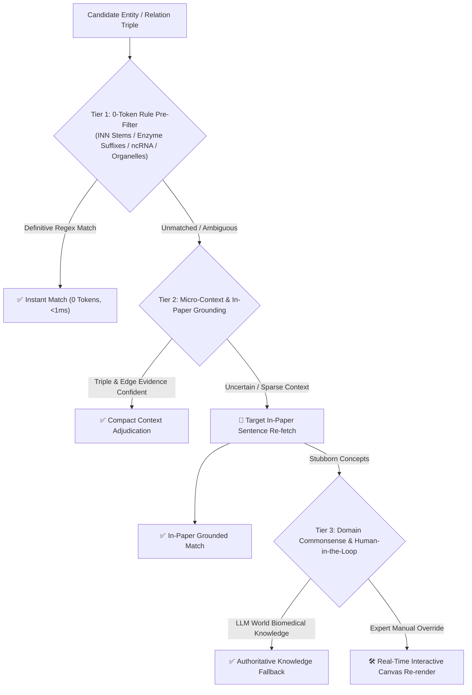
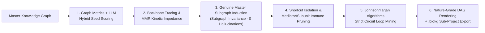

<p align="right">
   <strong>English</strong> &nbsp;｜&nbsp; <a href="README.md">中文</a>
</p>

<div align="center">

# 🧬 Bio-Graph Agent

**A Cross-Literature Incremental Biological Knowledge Graph, Multimodal Mechanism Discovery & Graph-Theoretic Circuit Decomposition Engine (v2.0)**

[](#)
[](#)
[](https://www.python.org/)
[](https://opensource.org/licenses/MIT)

</div>

This project addresses long-text structured extraction, top-tier multimodal mechanism pathway transcription, multi-scale authoritative scientific ontology categorization, and graph-theoretic regulatory circuit decomposition for biomedical research. Leveraging the context understanding, multimodal vision transcription, and rigorous reasoning capabilities of modern Large Language Models (LLMs) alongside classical graph theory algorithms, we built a **Bio-Knowledge Graph LLM Agent** that extracts information from literature (PDFs), performs dual-layer reflective audits, transcribes upfront pathway diagrams multimodally, aligns cross-literature semantics, classifies hierarchical ontologies, and achieves **high-cohesion signaling pathway decomposition and secondary downstream analysis**.

---

## 🎯 Project Motivation & Scientific Value (Why this project?)

A classic pain point in biomedical research is: **How do we uncover highly valuable novel research topics within an ocean of literature?**

In biology, it is common that "Molecule A regulates Protein B" and "Protein B regulates Biological Phenotype/Physiological System C" exist as isolated findings published in different years and distinct journals. However, **proving the regulatory cascade pathway "A mediates and influences C via B" is often a research topic of immense scientific value—one that can directly support a major grant proposal or breakthrough study.**

Relying on manual reading to piece together such cross-literature cascades is exceedingly slow and error-prone. Moreover, generic LLMs easily hallucinate false biological interactions or invert causal directions.

**Bio-Graph Agent** was engineered precisely to conquer this challenge as an "intelligent scientific research counselor":
1. **Multi-Paper Ingestion**: Rapidly and accurately parses complex, long academic papers, sniffing and multimodally transcribing Graphical Abstracts and core pathway figures upfront.
2. **Bridging Knowledge Silos**: Through AI semantic alignment and online PubMed/PMID validation, entities (molecules, proteins, physiological systems) and their hidden relations across disparate papers are cross-linked into a unified network.
3. **Intuitive Topological Rendering**: Automatically generates scientifically standardized dynamic regulatory topologies, enabling researchers to discover latent `A ➔ B ➔ C` cascade pathways at a single glance.
4. **Graph-Theoretic Pathway Decomposition**: Deconstructs massive, tangled whole-graph networks into discrete, cohesive, and causally sound **signaling pathways and autoregulatory circuits**, enabling researchers to export them as independent sub-projects for secondary targeted deep-dives.

---

## 🎨 Topological Network Visual Specification

This system strictly follows biomedical regulatory network standards for visual rendering:
* **🟢 Green Solid Line + Arrow**: Positive regulation / Activation / Promotion ($A \to B$).
* **🔴 Red Solid Line + Arrow**: Negative regulation / Inhibition / Downregulation ($A \dashv B$).
* **⚪ Gray Solid Line**: General correlation / Undirected association ($A \sim B$).
* **⚠️ Gray Dashed Line (---)**: Mechanism shortcut edges (condensed macro pathways; transparently isolated during circuit decomposition to expose granular cascades).
* **🟣 Purple Solid Line**: Hierarchical containment / Subunit / Family membership ($A \subset B$).
* **🔮 Dynamic Node Popularity**: Node radius scales dynamically with its degree centrality across papers. Hovering over any node reveals cross-literature aliases, supporting textual evidence, and exact literature provenance.
* **🔀 Dual Layout Engines**: Seamlessly toggle between **ForceAtlas2 Physics Layout** (ideal for macro cluster self-organization) and **Hierarchical Left-to-Right DAG Layout** (aligning with Nature/Cell standards where cascades flow strictly from upstream to downstream).

---

## 🌟 Core Features & Operational Guide

### ⚙️ I. Initial Environment & Retrieval Setup
* 🌐 **Flexible LLM Engines**: Supports cloud APIs (Tencent Cloud, OpenRouter, SiliconFlow, etc.) and native **Ollama** offline execution for handling confidential biomedical data without internet access.
* 📚 **Intelligent Retrieval Sources**: Built-in dual search engines for PubMed (authoritative biomedical literature) and Semantic Scholar (all-discipline AI-driven high-speed retrieval with automatic rate-limit fallback).
* ⚡ **Multi-Threaded Concurrency (Concurrency Workers)**: Configurable thread pool (1-8 workers) driving parallel chunk extraction and concurrent pathway figure transcriptions, slashing parsing time by 5-10x.
* 🛡️ **Relation Node Literature Grounding**: Automatically regex-verifies unregistered relation endpoints against the original paper text after chunk analysis. Real entities are recovered; hallucinated edges are strictly dropped.
* 👁️ **Dedicated Multimodal Vision Models**: Mount dedicated vision models (such as Gemini 2.5 Flash-Lite, Gemini 3.8 Flash, or Qwen 2.5 VL 72B) to transcribe pathway figures with precision.

### 📂 II. Knowledge Graph Construction (Dual Startup)
* 💡 **Zero-Based Cold Start**: Have no papers on hand? Simply input your research direction in natural language (e.g., *"Role of macrophage polarization in tumor microenvironment"*). AI formulates professional queries, retrieves cutting-edge papers, and constructs your initial graph.
* 📄 **Precise Local Literature Analysis**: Drag in a PDF, specify page ranges, or enable abstract-only mode. With "🔗 Append Mode" enabled, newly parsed literature integrates and grows continuously into the existing graph.
* 📷 **Upfront Multimodal Vision Strategy**: Choose between `Off (Pure Text)`, `🎯 Keyword Match` (e.g., *Fig 4*, *pathway*), and `⚡ Extract All in Pages` to capture graphical abstracts and mechanism figures.

### 🎨 III. Visual Empowerment Engine & Topological Standards
* 👁️ **Mechanism Shortcuts**: Reveals express pathways bypassing intermediate nodes to view macro upstream-to-downstream regulatory outcomes.
* 🧬 **Ontology Empowerment (Containment Feedback)**: Feed back weights of micro-entities to macro parent categories (e.g., Kinase Families), amplifying key signaling families.
* 🔥 **Node Empowerment (Degree Centrality)**: Hub genes with dense molecular connections dynamically scale up in node size.
* 🔗 **Edge Empowerment (Consensus Boldening)**: Regulatory edges validated by multiple papers and rich textual evidence chains are automatically bolded.

### 🤖 IV. AI Intelligent Research Assistant
In the right-hand 🤖 **Ask AI** panel, four automated tools are integrated:
* 🧹 **Smart Pruning (Tree Cleaning)**:
  - **Topological Diagnosis**: Scans whole-graph logic to recommend synonymous node merges, hierarchical containment, and shortcut downgrading.
  - **🧲 Symmetric Relation Folding**: Automatically merges bidirectional $A \leftrightarrow B$ correlation lines into a single undirected edge, summing popularity and preserving evidence chains without loss.
  - **🔄 Mutual Containment Deadlock Resolution**: Detects and resolves reciprocal containment loops ($A \subset B$ and $B \subset A$).
  - **🧪 Coarse Relation Purification**: Selectively consolidates or strips vague correlation lines without early information loss.
  - **✂️ Intent-Based Node Cleaning (Intent Pruning)**: Enter your research focus to eliminate off-topic organs, drugs, or bystander molecules.
* 🔍 **Smart Expansion**: Select core nodes; AI formulates advanced background queries to pull the latest PubMed papers and enqueues them for **Autopilot Continuous Assimilation**.
* 🔗 **Smart Bridging**: Select any two seemingly unconnected molecules A and B; AI navigates the network to find hidden multi-step cascades or searches external literature to uncover unverified regulatory hypotheses.
* 📖 **Ask AI (Micro-Mechanism Explanations)**: Click any node or edge on the canvas to pass its micro-context (raw extraction evidence and literature origin) to the LLM, producing an in-depth biological mechanism essay directly suitable for grant proposals.

### ✂️ V. Expert Manual Intervention (Data Management Center)
Provides surgical precision over the graph:
* **Global Cleanup**: Eliminate isolated orphan nodes or batch-rename messy literature source tags across all connected nodes and edges.
* **Node Surgery**: Rename nodes, **Force Merge** (transfer all edges of Node A to Node B and remove A), or **Split Node** (reallocate edges to two newly split sub-nodes).
* **Edge Operations**: Reverse upstream/downstream directions, switch relation categories, edit textual evidence, sever false-positive edges, or manually add newly confirmed experimental links.

### 💾 VI. Project Workspaces & Central Memory Vault (Self-Healing Architecture)
* 🗂️ **Project Isolation (`projects/<project_id>/`)**: Every research topic has an independent workspace directory storing its private `project.biokg` (the single source of truth) and attached PDFs. Freely create blank projects, switch between historical topics, or permanently delete old topics to reclaim disk space.
* 🏛️ **Central Memory Vault (`vault/`)**: All imported literature is registered in `literature_registry.json` via SHA-256 physical cryptographic hashes, preventing duplicate file storage across different projects.
* 🌐 **Automatic Standard Literature Renaming & Online PMID Alignment**: One-click online alignment with PubMed/DOI. Cryptic or temporary PDF filenames are automatically reconstructed into academic standards (e.g., `PMID: 35123456 | Article_Title.pdf`), and all node/edge provenance tags are updated seamlessly.
* 🩹 **Missing Literature Detection & Self-Healing Replenishment**: When moving projects across machines or relocating PDFs, the system automatically detects missing physical files, searches the Central Vault by file hash, and restores physical links with a single click.
* 📷 **Multimodal Figure Source Exemption**: Nodes and edges originating from mechanism figures carry tags such as `[Figure: Page1_Fig1 (P.1)]` and are permanently tied to their parent paper, enjoying auto-healing exemption.
* 💾 **Legacy Project Compatibility**: Seamless export and import of `.biokg` archive files.

### 📷 VII. Upfront Multimodal Vision Pathway Transcription & Spatial Clustering
In high-impact journals (Nature, Science, Cell), the densest regulatory conclusions are concentrated in Graphical Abstracts and molecular pathway diagrams:
* **Spatial Clustering Composite Algorithm (`_cluster_page_figures`)**: Automatically detects multi-layered and sliced raster layers in PDFs, merging overlapping fragments via disjoint-set clustering and rendering crisp 150-DPI composite images.
* **Balanced Vector Diagram Detection**: Accommodates single-page pathway posters (`drawings >= 10`) and multi-page papers (requiring figure keywords and `drawings >= 25`), avoiding false positives on plain text pages while reliably preserving real vector pathways.
* **Multi-Threaded Parallel Vision Transcription**: Concurrently transcribes candidate figures using dedicated multimodal models (Gemini 2.5/3.8 Flash, Qwen 2.5 VL 72B), injecting transcribed mechanism texts into the downstream extraction stream.

### ⚡ VIII. Chunk-Centric High-Purity Closed-Loop Pipeline & Multi-Threaded Concurrency
* **Chunk-Centric Localized Pipeline**: Solves the severe hallucination problem caused by global dictionary contamination. Each chunk extracts local entities and derives relations strictly grounded in local context.
* **High-Throughput Concurrency**: Built upon `concurrent.futures.ThreadPoolExecutor`, processing chunks and figures in parallel to achieve 5-10x parsing acceleration.

### 📊 IX. Graph Analysis Workbench & Three-Tier Classification
To satisfy the rigorous needs of domain specialists for granular entity taxonomy classification and deep mechanism verb distillation (e.g. catalytic phosphorylation, competitive binding, transcriptional activation), the system provides an independent second-stage workbench:
* **Bidirectional Seamless Routing**: Click `📊 Go to Graph Analysis Workbench ➔` beneath the main canvas for instant transit. Sticky return buttons on the top and bottom preserve 100% of the session state.
* **6 Built-in Authoritative Ontology Schemas & Interdisciplinary Support**:
  1. `universal_biored`: NIH/NLM BioRED authoritative benchmark (6+1 entity types, 6 mechanism types);
  2. `molecular_signaling`: Intracellular signaling cascades, kinases, and post-translational modifications;
  3. `pharmacology_target`: Drug molecules, druggable targets, MoA mechanisms, and clinical indications;
  4. `immunology_tme`: Immune cell subsets, tumor microenvironment, and immune checkpoint signaling;
  5. `ecology_ecosystem`: Ecosystem science, trophic feeding, biogeochemical cycles, and environmental drivers;
  6. `ethology_behavior`: Animal behavior, neuroendocrine drivers, sign stimuli/releasers, and social tradeoffs.
* **Rule Folder Management Console**:
  - Click `📁 Open Rules Folder` to directly reveal the `ontology_presets/` directory in your OS file manager;
  - Includes bilingual specification guides (`README_RULE_FRAMEWORK_GUIDE_EN.txt` and `请先读我_规则框架构建指南_ZH.txt`);
  - Drop any custom `.json` rule file into the folder and click `🔄 Refresh Presets` for instantaneous hot-loading.
* **Sparse Dynamic Dashboard**: Only renders categories with `count > 0`, featuring expandable accordions for interactive drill-down into constituent nodes and rationales.
* **Scholar Manual Override Console (Human-in-the-Loop)**: Allows researchers to interactively reclassify entities or modify mechanism verbs with instant cache updates and visual re-rendering.
* **Scientific Multi-Shape Categorical Topology & Bilingual Legend**: Maps entity types to distinct geometric shapes and colors, featuring an embedded, semi-transparent, collapsible bilingual legend overlay.

### 🔬 X. Signaling Pathway & Autoregulatory Circuit Decomposition (Stage 2)
Macro-level biological knowledge graphs often contain hundreds of interconnected nodes forming a tangled "spiderweb" network. The **Pathway Decomposition Module** leverages a hybrid of graph theory and LLM scientific reasoning to distill high-cohesion, causal regulatory sub-pathways:

#### 📖 Operational Step-by-Step Guide:
1. **Accessing the Module**: In the Graph Analysis Workbench, scroll down to the `🔬 Signaling Pathway & Autoregulation Circuit Decomposition` control console.
2. **Specifying Research Focus Prompt (Optional)**:
   - In the "Research Academic Focus (Prompt)" input box, specify targeted exploration axes, for example: `Focus on the causal link between mitochondrial dysfunction and Tau protein aggregation` or `Investigate neuroprotective mechanisms mediated by the CRL5-SOCS4 E3 ubiquitin ligase complex`;
   - If left blank, the algorithm operates on pure graph-theoretic topology (degree centrality, betweenness, clustering coefficients) to unearth dominant causal backbones autonomously.
3. **Setting Pathway Count**: Select the number of pathways to decompose (default is 3, range 1-10).
4. **Triggering Decomposition**: Click `⚡ Start Pathway & Circuit Decomposition`. Within seconds, the system executes hybrid seed scoring, master graph subgraph induction, kinetic impedance MMR traversal, cycle mining, and leaf pruning.
5. **Examining Pathway Cards**:
   - **Scholarly Title & Mechanism Summary**: Review domain-specific pathway titles and mechanistic narratives derived strictly from topological connections;
   - **Autoregulatory Feedback Loop Diagnostics**: Automatically highlights identified causal loops, such as negative homeostatic feedback ($A \to B \to C \dashv A$) or positive feedback spirals ($A \to B \to C \to A$);
   - **Interactive Canvas with Dual Layouts**:
     - Toggle between **Hierarchical Left-to-Right DAG Layout** (causal directional cascade) and **ForceAtlas2 Layout** (physics self-organization);
     - Green arrows denote activation/promotion, red flatheads/arrows denote inhibition/suppression, with explicit biochemical verbs labeled on edges;
     - Hover over nodes for cross-literature aliases; hover over edges for exact textual evidence and paper provenance.
6. **Export Options & Secondary Downstream Analysis**:
   - `🌐 Export Standalone Webpage (HTML)`: Download self-contained interactive visualization pages for conference presentations or manuscript supplements;
   - `📋 Export Topology Data (JSON)`: Extract structured graph data containing nodes, edges, polarities, mechanisms, and literature evidence;
   - `🧬 Export as Project (.biokg)` (**Core Highlight**):
     - Packages the selected pathway into a standard BioKG 2.0 independent project archive (e.g., `BioKG_Pathway_1_ROS_proteasome.biokg`);
     - **Complete State Inheritance**: Inherits all entities, genuine relations, cited literature registries, and **preserves existing workbench ontology annotations**;
     - **Secondary Deep Dives**: Navigate to the main builder workspace, click "📥 Load History Project (.biokg)", and open this sub-pathway as a dedicated mini-project to perform targeted smart expansion, bridging, or further experimental design!

---

## 🤖 The Core Role of the Multi-Agent System Across the Lifecycle

Rather than using LLMs as mere "text summarizers," this system builds an autonomous multi-agent framework tailored for rigorous biomedical research across model ecosystems (supporting Gemini, DeepSeek, GLM, Qwen, Tencent Hunyuan, and local private Ollama). Ten specialized agents coordinate across the graph lifecycle:

```text
┌────────────────────────────────────────────────────────────────────────────────────────┐
│                              🧠 LLM Agent Architecture Core                            │
└───────────────────────────────────────────┬────────────────────────────────────────────┘
                                            │
       ┌────────────────────────────┬───────┴────────────────────┬───────────────────────┐
       ▼                            ▼                            ▼                       ▼
【Phase 1: Ingestion & Vision】 【Phase 2: Audit & Alignment】 【Phase 3: Topology Pruning】 【Phase 4: Ontology & Decomposition】
 1. Long-Context Ingestion Hub   3. Dual-Layer Reflection Insp. 5. Topology Pruning Expert    9. Ontology & Mechanism Architect
 2. Multimodal Figure Transcrib. 4. Cross-Literature Align Judge 6. Symmetric & Loop Resolver  10. Pathway & Circuit Mining Expert
                                                                7. Web Exploration & Bridging
                                                                8. Vault Self-Healing Auditor
```

### 1. Long-Context Ingestion Hub
Leverages modern long-context windows to act as a "scientific speed-reader," extracting standardized biological entities and regulatory mechanisms from multi-page PDFs without losing inter-paragraph context.

### 2. Multimodal Figure Transcriber
Collaborates with multimodal vision models to transcribe Graphical Abstracts and signaling pathway diagrams into structured biochemical cascade texts.

### 3. Dual-Layer Reflection Inspector
Employs a two-stage "Initial Extraction - Reflection Audit" pipeline. The reflection auditor cross-examines the draft against original sentences, retaining only edges with incontrovertible evidence.

### 4. Cross-Literature Semantic Alignment Judge
Overcomes surface lexical barriers. By comparing entity names and alias lists across papers, it executes semantic-level reconciliation (e.g., mapping `p53` and `TP53`), weaving isolated findings into a cohesive network.

### 5. Topology Pruning Expert
Reads full-graph topological logic to recommend shortcut downgrades, hierarchical memberships, and intent-based pruning of off-topic branches.

### 6. Symmetric & Hierarchy Loop Resolver
Automatically merges bidirectional correlation redundancies ($A \leftrightarrow B$) into undirected bonds and resolves reciprocal containment deadlocks ($A \subset B$ and $B \subset A$).

### 7. Web-Browsing Explorer (Expansion & Bridging Guide)
Generates targeted PubMed queries to autonomously retrieve literature for isolated nodes, and charts multi-step bridging cascades between distant molecules.

### 8. Literature Registry & Auto-Healing Auditor
Tracks literature via SHA-256 physical cryptographic hashes, aligns papers with official PubMed PMIDs, and executes automated self-healing across devices.

### 9. Ontology & Mechanism Escalation Architect
Orchestrates the three-tier classification architecture across zero-token rule filters, micro-context reasoning, in-paper sentence re-fetching, and domain knowledge fallbacks to elevate coarse graphs into fine-grained scientific mechanism networks.

### 10. Pathway & Circuit Mining Expert
Combines graph-theoretic mathematics (degree distribution, betweenness centrality, cycle detection) with LLM scientific adjudication to induce cohesive subgraphs, isolate shortcut edges, and produce peer-review-grade causal pathway reports.

---

## 🌟 Core Technical Highlights

### ⭐ Major Highlight 1: Three-Tier Rule-LLM Hybrid Classification Engine

Traditional LLM classification either relies entirely on prompts (high token costs, long latency, category drift) or rigid dictionaries (inability to handle rare entities and polysemous terms). Bio-Graph Agent introduces an innovative **Three-Tier Classification Architecture**:



1. **Tier 1: Deterministic 0-Token Rule Pre-Filter**
   - Implements high-precision regex patterns based on biomedical nomenclature standards (e.g., INN drug stems `-mab` monoclonal antibodies, `-nib` kinase inhibitors, `-stat` enzyme inhibitors; enzyme suffixes `-ase`, kinases `-kinase`; ncRNA standards `miR-`, `lncRNA-`; subcellular organelles; standard model organisms);
   - Delivers **instant sub-millisecond matching at zero token cost**. Benchmark evaluations show over 40% of canonical nodes are definitively resolved in Tier 1.
2. **Tier 2: Micro-Context & Targeted In-Paper Literature Grounding**
   - For unresolved entities, extracts local topological micro-contexts (aliases, 1-hop neighbor triples, extracted textual evidence) for compact, high-precision LLM reasoning;
   - If ambiguity persists (`Uncertain`), the system scans the underlying raw PDF using targeted regex to **extract only sentences containing the entity and its neighbors**, bypassing expensive whole-paper re-reads.
3. **Tier 3: Domain Commonsense Fallback & Human-in-the-Loop Override**
   - Resolves edge cases by consulting the LLM's comprehensive biomedical world knowledge;
   - **Scholar Manual Override Console**: Equips researchers with an interactive UI to modify entity classifications or fine-tune mechanism verbs (e.g., reclassifying "downregulation" to "catalytic ubiquitination-mediated degradation"), automatically synchronizing to cache and re-rendering the topology.

---

### ⭐ Major Highlight 2: Graph-Theoretic Pathway Decomposition & Autoregulation Circuit Mining

Allowing LLMs to hallucinate pathways from an entire graph often leads to inverted causality and fictitious edges. Bio-Graph Agent couples **rigorous graph theory constraints** with **LLM semantic adjudication**:



1. **LLM-Graph Hybrid Seed Scoring**
   - Blends topological centrality metrics (Degree Centrality, Betweenness Centrality, Local Clustering Coefficients) with LLM scientific priority scores guided by the user's research prompt.
   - Accurately identifies pivotal biological "seeds" possessing both network centrality and clinical/mechanistic exploration value.
2. **Strict Subgraph Invariance (Zero Fictitious Edges)**
   - Subgraphs are strictly induced from `master_entities` and `master_relations`;
   - Every single node and edge 100% originates from the verified master graph, preserving raw polarities, weights, and verbatim literature evidence. Zero hallucinated connections.
3. **Backbone Spine Tracing & Kinetic Impedance MMR Exploration**
   - Traverses directional regulatory cascades (promotions, inhibitions, catalytic conversions) upstream and downstream;
   - Implements a Maximal Marginal Relevance (MMR) kinetic impedance model: penalizes previously explored nodes to dynamically steer subsequent pathways toward unmapped mechanistic axes, guaranteeing diversity across decomposed circuits.
4. **Strict Autoregulatory Cycle / Feedback Loop Mining**
   - Executes Johnson / Tarjan strongly connected component cycle detection algorithms to pinpoint closed causal loops;
   - Distinguishes **negative homeostatic feedback** ($A \to B \to C \dashv A$) from **positive feedback loops / vicious cycles** ($A \to B \to C \to A$ or double negative inhibition $A \dashv B \dashv A$).
5. **Shortcut Edge Isolation & Mediator/Subunit Immune Pruning**
   - **Shortcut Isolation**: Filters out macro jump-edges (e.g. bypassing intermediate kinases) to expose granular, multi-step regulatory mechanisms;
   - **Topological Immunity Protection**: Grants pruning immunity to critical path mediators, feedback loop participants, and multi-protein complex subunits during leaf compaction, safeguarding biological mechanism continuity.
6. **Sub-Project Downgrade Packaging & Secondary Analysis (`.biokg` Export)**
   - Decomposed pathways can be exported as standard BioKG 2.0 independent project archives;
   - Automatically subsets entities, genuine edges, cited literature registries, and **inherits existing ontology annotations**, ready to be re-loaded into the primary workspace for secondary expansion and hypothesis generation.

---

### Additional Core System Highlights

3. **Long-Document Structured Extraction**: Ingests multi-page biomedical PDFs directly to produce structured JSON containing standard names, aliases, interaction types, and verbatim evidence.
4. **First-of-its-Kind Agent Dual-Layer Reflection**: An independent quality auditor checks every extraction against the source text, discarding unsupported claims.
5. **Cross-Literature Alignment & Automatic Online PMID Renaming**: Dynamically meshes multi-paper graphs and automatically renames literature files into standard `PMID: XXXXXXXX | Title.pdf` formats via PubMed/DOI.
6. **Dynamic Topological Visualization**: Powered by Pyvis, featuring degree-centrality node scaling and consensus-weighted edge boldening without external network dependencies.
7. **Intelligent Pruning, Symmetric Folding & Intent Cleaning**: Diagnoses graph topology, folds bidirectional correlation lines, resolves containment deadlocks, and strips off-topic nodes via natural language prompts.
8. **Autonomous Expansion & Hidden Path Bridging**: Expands peripheral nodes in autopilot mode and mines multi-step cascade pathways between unlinked targets.
9. **Micro-Context Biological Interpretation**: Select any node or edge to feed its evidence and citation provenance to the LLM, producing grant-ready mechanism reports.
10. **Project Isolation & Central Memory Vault**: Workspace-level physical isolation with cross-project SHA-256 deduplication and one-click self-healing for missing files.
11. **Chunk-Centric Localized Pipeline & Multi-Threading**: Independent chunk extraction eliminates global hallucination contamination while concurrency boosts throughput by 5-10x.
12. **Spatial Clustering & Balanced Vector Pathway Extraction**: Disjoint-set clustering merges fragmented image slices into pristine mechanism figures, while balanced vector thresholds accommodate both posters and papers.

---

## 📂 Core Code Architecture

```text
├── app.py                      # Streamlit frontend UI (workspaces, project switching, analysis workbench)
├── back_logic.py               # Central execution pipeline (chunk-centric concurrency & vision workflow)
├── workbench_engine.py         # Graph Analysis Workbench engine:
│                               #   ├── RulePreFilter (0-Token regex pre-filter)
│                               #   ├── OntologyManager (Dynamic preset scanning & manager)
│                               #   ├── WorkbenchAnalysisEngine (4-tier escalation scheduler)
│                               #   └── PathwayDecompositionEngine (Graph-theoretic pathway mining & .biokg export)
├── ontology_presets/           # Authoritative biomedical ontology presets:
│   ├── universal_biored.json   #   ├── NIH/NLM BioRED universal benchmark (6+1 entities / 6 mechanisms)
│   ├── molecular_signaling.json#   ├── Molecular signaling & post-translational modifications
│   ├── pharmacology_target.json#   ├── Pharmacology & drug target MoA evaluation
│   ├── immunology_tme.json     #   ├── Tumor microenvironment & immune communication networks
│   ├── ecology_ecosystem.json  #   ├── Ecosystem trophic feeding & biogeochemical cycles
│   ├── ethology_behavior.json  #   ├── Ethology, neuroendocrine drivers & behavioral repertoires
│   ├── README_RULE_FRAMEWORK_GUIDE_EN.txt # Rule framework specifications & templates
│   └── 请先读我_规则框架构建指南_ZH.txt
├── LLM_SYS.py                  # LLM Agent core (reflection, symmetric pruning, alignment, transcription)
├── IO_SYS.py                   # Infrastructure layer (PyMuPDF spatial clustering, vector rendering, workbench Pyvis visualizer)
├── WebSearcher.py              # Web retrieval module (PubMed / Semantic Scholar search & PMID lookup)
├── projects/                   # Dedicated project workspaces:
│   └── <project_id>/
│       ├── project.biokg       # Single source of truth (BioKG 2.0 standard archive)
│       ├── graph_state.json    # Backward-compatible persistence state
│       ├── papers/             # Bound physical PDF files
│       └── pathways/           # Pathway decomposition persistence snapshot directory:
│           ├── pathways_manifest.json # Pathway metadata, titles, summaries, and loops
│           ├── pathway_*.html  # Standalone interactive HTML visualizations
│           └── pathway_*_topology.json # Structured topology JSON datasets
├── vault/                      # Central Memory Vault:
│   └── literature_registry.json# Global SHA-256 fingerprint & metadata registry
├── requirements.txt            # Project dependencies
├── run.sh                      # Linux / WSL startup script
├── start.bat                   # Windows startup script
├── README.md                   # Project documentation (Chinese)
└── README_EN.md                # Project documentation (English)
```

---

## 🚀 Quick Start

### 1. Clone Repository & Install Dependencies

```bash
git clone https://github.com/24238-T-34/Bio-Graph-Agent
cd Bio-Graph-Agent
pip install -r requirements.txt
```

### 2. Configure and Run Project

* **Method 1 (Linux / WSL)**:
  ```bash
  chmod +x run.sh
  ./run.sh
  ```
* **Method 2 (Windows)**:
  Double-click `start.bat` (or `start_wsl.bat`).
* **Method 3 (Standard Streamlit Command)**:
  ```bash
  streamlit run app.py
  ```

Open the Streamlit interface in your browser, enter your API Key in the sidebar (or run key-free using local Ollama), upload PDFs, and watch your dynamic biological knowledge graph emerge!

---

## 📅 Future Work

* [x] **Secondary Correlation Filter & Pruning**: LLM-driven topology diagnostics, intent-based pruning, and orphan elimination. (✅ **v1.0 Completed & Merged**)
* [x] **Multi-Threaded Concurrency & Parallel Pipeline**: Chunk-centric parallel extraction and concurrent pathway figure transcriptions, boosting throughput by 5-10x. (✅ **v2.0 Completed & Merged**)
* [x] **Multimodal Pathway Figure Extraction**: Spatial clustering for composite figures, balanced vector diagram detection, and parallel vision transcription with Gemini/Qwen-VL. (✅ **v2.0 Completed & Merged**)
* [x] **Project Isolation & Central Memory Vault**: Physical project isolation, global SHA-256 deduplication, automatic online PMID renaming, and physical self-healing. (✅ **v2.0 Completed & Merged**)
* [x] **Symmetric Relation Folding & Containment Deadlock Resolution**: Bidirectional correlation consolidation and hierarchical loop resolution. (✅ **v2.0 Completed & Merged**)
* [x] **Graph Analysis Workbench & Three-Tier Classification**: Second-stage scientific workbench with 0-token pre-filtering, micro-context reasoning, targeted in-paper grounding, and manual override consoles. (✅ **v2.0 Completed & Merged**)
* [x] **Graph-Theoretic Pathway Decomposition & Autoregulation Circuit Mining**: Blends hybrid seed scoring, master subgraph induction, kinetic impedance MMR traversal, cycle mining, shortcut filtering, and `.biokg` secondary project export. (✅ **v2.0 Completed & Merged**)
* [x] **Cross-Disciplinary Multi-Scale Ontology Expansion**: Built-in rules and regex patterns for ecosystem science and ethology. (✅ **v2.0 Completed & Merged**)
* [ ] **Multi-Attribute Topological Coloring**: Categorical coloring based on entity types (genes, diseases, compounds, phenotypes) for heightened biological intuition.
* [ ] **LLM Dynamic Routing Engine / MoE**: Two-tier model routing directing routine text cleaning to high-speed models, while semantic alignment, reasoning, and vision tasks run on premier LLMs.
* [ ] **Hypothesis & Writing Copilot**: Multi-page AIGC writing bay capable of autonomous structural hole exploration and one-click grant background draft generation.
* [ ] **Edge Metadata & Biological Conditions**: Conditional constraints (cell lines, mutations, experimental parameters) attached to edges as hover tooltips, separating empirical facts from topological hypotheses.
