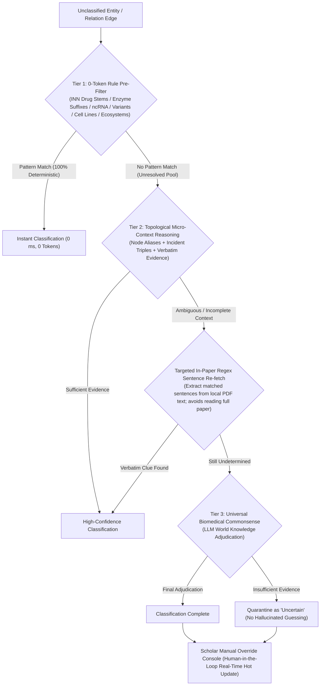

<p align="right">
   <strong>English</strong> &nbsp;｜&nbsp; <a href="README.md">中文</a>
</p>

<div align="center">

# 🧬 Bio-Graph Agent

**A Cross-Literature Incremental Biological Knowledge Graph & Multimodal Mechanism Discovery Engine (v2.0)**

[](#)
[](https://www.python.org/)
[](#)
[](https://opensource.org/licenses/MIT)

</div>

This project addresses the demands of long-text structural extraction, multimodal pathway transcription from top-tier journals, and scientific hypothesis grounding in the biomedical and broader life sciences domains. Leveraging the long-text comprehension, multimodal vision transcription, and rigorous reasoning capabilities of modern Large Language Models (LLMs), deeply intertwined with **graph-theoretic topological analysis, a three-tier rule-LLM hybrid classification engine, and causal autoregulatory circuit mining algorithms**, we have built a **Bio-Knowledge Graph LLM Agent** capable of automated extraction from literature (PDFs), dual-layer reflective quality audits, upfront pathway diagram transcription, cross-literature semantic alignment, multi-tier ontology escalation, localized pathway decomposition, and dynamic, highly interactive regulatory topology rendering.

---

## 🎯 Project Motivation & Scientific Value (Why this project?)

A classic and monumental pain point in biomedical research is: **How do we identify novel, high-impact research topics and causal regulatory hypotheses across vast oceans of scientific literature?**

In biological systems, it is common that "Molecule A regulates Protein B" and "Protein B regulates Biological/Disease Phenotype C" are documented in disparate papers published years apart across distinct journals. However, **proving the complete regulatory cascade "A mediates and influences C through the pivotal intermediate node B" ($A \to B \to C$) is frequently a discovery of immense scientific value—one that directly supports major grant proposals or foundational breakthrough studies.**

Relying on traditional manual reading to piece together such cross-literature cascade chains is exceedingly slow, vulnerable to oversights, and constrained by individual cognitive blind spots.

**Bio-Graph Agent** was created precisely to solve this problem as an "intelligent research counselor" and "mechanism exploration copilot":
1. **Multimodal Dual-Track Ingestion**: Accurately extracts structured causal assertions from complex text and transcribes high-density Graphical Abstracts and vector/raster molecular pathway figures upfront.
2. **Bridging Knowledge Silos**: Through cross-literature semantic entity alignment and online PubMed/PMID validation, entities (genes, proteins, metabolites, cell subpopulations, disease phenotypes, environmental factors) across independent papers are woven into an integrated network.
3. **Three-Tier Ontology Escalation**: Combines 0-token regex rule pre-filters, topological micro-context reasoning, and targeted in-paper sentence grounding to accurately classify entities and distill deep biochemical mechanism verbs (e.g., catalytic phosphorylation, ubiquitination degradation, transcriptional activation).
4. **Graph-Theoretic Pathway Decomposition**: Combines topological centrality measures with LLM biological research priority scoring to decompose dense master networks into high-cohesion signaling pathways, uncovering positive/negative autoregulatory feedback loops ($A \to B \to C \dashv A$) and enabling downgrade export as standalone sub-projects for secondary downstream analysis.

---

## 🎨 Topological Network Visual Specification

The system strictly adheres to biomedical and molecular biology visual standards for regulatory network visualization:
* **🟢 Green Solid Line + Arrow ($\to$)**: Represents **Positive regulation / Activation / Promotion / Upregulation**.
* **🔴 Red Solid Line + Bar/Arrow ($\dashv$)**: Represents **Negative regulation / Inhibition / Blockade / Degradation**.
* **⚪ Gray Solid Line ($\sim$)**: Represents **General association / Interaction with undetermined polarity**.
* **⚠️ Gray Dashed Line ($---$)**: Represents **Mechanism shortcut edges**, denoting coarse macro assertions that bypass intermediate mediators; automatically isolated in pathway decomposition.
* **🟣 Purple Solid Line ($\subset$)**: Represents **Hierarchical containment / Complex subunit / Family membership**.
* **🔮 Dynamic Node Popularity & Morphology Mapping**:
  - In the main graph, node diameter scales dynamically with whole-network degree centrality;
  - In the Graph Analysis Workbench, entities map to 10 distinct geometric shapes (dot, diamond, triangle, triangleDown, square, hexagon, star, ellipse, etc.) according to the NIH BioRED standard;
  - Hovering over any node displays aliases, assigned ontology classes, verbatim text evidence, and exact paper citations.
* **📐 Dual-Layout Rendering Engine**:
  - **Hierarchical DAG Layout (Left-to-Right)**: Strictly aligns causal flow from upstream inducers to downstream phenotypes;
  - **ForceAtlas2 Physics Layout**: Dynamic spring-force simulation displaying clustered molecular multi-body complexes.

---

## 🌟 Core Features & Operational Guide

### ⚙️ I. Initial Setup & LLM Configuration
* 🌐 **Multi-Model Ecosystem Support**: Seamlessly switch across cloud APIs (OpenAI, Anthropic, Gemini, DeepSeek, SiliconFlow, OpenRouter, Tencent Cloud) and local **Ollama** offline private deployments for zero-data-leakage environments.
* 📚 **Dual Authoritative Retrieval Engines**: Integrated PubMed (the gold standard for biomedicine) and Semantic Scholar (broad AI-driven retrieval with automatic rate-limit degradation and retry backoff).
* ⚡ **High-Concurrency Parsing Pool (Concurrency Workers)**: Configurable multi-threaded pool (1–8 workers) executing chunk extraction and multimodal pathway transcription in parallel, slashing parsing times for multi-page papers.
* 🛡️ **Relation Node Literature Grounding**: Automatically scans original paper text with regular expressions if a relation endpoint is missing from the entity roster; authentic entities are recovered while hallucinations are strictly dropped.
* 👁️ **Dedicated Multimodal Vision Mounting**: Mount specialized vision models (e.g., Gemini 2.5 Flash-Lite, Gemini 3.8 Flash, Qwen 2.5 VL 72B) dedicated to pathway diagram transcription.

### 📂 II. Knowledge Graph Construction (Dual Startup Modes)
* 💡 **Mode A: Zero-Based Cold Start**: No local PDFs? Simply type your research topic in natural language (e.g., *"Microglial activation mediating neuroinflammatory signaling in Alzheimer's disease"*). The AI formulates scholarly PubMed search strings, fetches external papers, and constructs your initial causal graph automatically.
* 📄 **Mode B: Local PDF Literature Ingestion**:
  1. Drag and drop single or multiple academic PDFs;
  2. Customize page parsing ranges (e.g., `1-12`) or enable the "Abstract-Only" ultra-fast mode;
  3. **🔗 Incremental Append Mode**: When enabled, newly parsed papers integrate smoothly into the existing graph without overwriting, enabling progressive graph expansion across literature sets.
* 📷 **Multimodal Upfront Vision Strategies**: Choose between `Off (Pure Text)`, `🎯 Keyword Match (Specific Figure Number)`, and `⚡ Extract All in Pages` to capture high-density Graphical Abstracts and pathway figures.

### 🎨 III. Visual Empowerment Engine & Interactive Topology
* 👁️ **Mechanism Shortcut Toggle**: Toggle visibility of macro shortcuts that skip intermediate mediators, balancing macro overviews with granular molecular cascades.
* 🧬 **Ontology Containment Feedback**: Propagate micro-entity connection weights upward to macro parent classes (e.g., Kinase Families), accentuating central signaling complexes.
* 🔥 **Degree Centrality Dynamic Scaling**: Hub molecules dynamically expand in node radius with increasing connections, highlighting core targets at a glance.
* 🔗 **Consensus Evidence Boldening**: Regulatory edges corroborated by multiple independent publications and robust verbatim evidence are automatically highlighted with bold strokes.

### 🤖 IV. AI Scientific Research Copilot (Ask AI Panel)
The collapsible 🤖 **Ask AI** panel integrates an automated suite for graph refinement and hypothesis generation:
* 🧹 **Smart Topology Pruning**:
  - **Topological Health Diagnosis**: Scans the network for ambiguous concepts, synonymous redundancies, and macro shortcuts;
  - **🧲 Symmetric Relation Folding**: Consolidates bidirectional $A \leftrightarrow B$ correlations into a single undirected edge, merging popularity and textual evidence without loss;
  - **🔄 Reciprocal Containment Loop Resolution**: Identifies and corrects mutual containment deadlocks ($A \subset B$ and $B \subset A$);
  - **🧪 Coarse Relation Purification**: Selectively consolidates or purges vague undirected associations;
  - **✂️ Intent-Guided Pruning**: Input a research scope to physically strip off-topic peripheral branches.
* 🔍 **Smart Expansion**: Select core nodes; the AI formulates targeted PubMed queries, pulls new papers, and assimilates them in an autopilot loop.
* 🔗 **Smart Bridging**: Select any two seemingly unconnected molecules; the AI navigates multi-step cascade routes or searches external literature to uncover hidden regulatory bridges.
* 📖 **Micro-Context Mechanism Interpretation**: Click any node or edge on the canvas to extract its verbatim textual evidence and citations; the LLM synthesizes an in-depth biological mechanism report directly usable in grant proposals.

### ✂️ V. Expert Surgical Intervention (Data Management Center)
Provides researchers with complete control over graph data:
* **Global Cleanup**: Eliminate orphan nodes with zero connections, or batch-rename messy literature source tags.
* **Node Surgery**: Rename nodes, **Force Merge** (transfer all edges of Node A to Node B and delete A), or **Split Node** (split a compound entity into two distinct subtypes and reassign incident edges).
* **Edge Operations**: Reverse upstream/downstream causal directions, switch interaction types, edit supporting evidence, or manually establish novel experimental links.

### 💾 VI. Project Isolation & Central Memory Vault (Self-Healing Architecture)
* 🗂️ **Workspace Physical Isolation (`projects/<project_id>/`)**: Each research project possesses a private directory holding its `project.biokg`, historical pathway snapshots, and bound PDFs. Freely create blank projects, switch across projects, or permanently delete obsolete projects.
* 🏛️ **Central Memory Vault (`vault/`)**: All imported literature is indexed by SHA-256 physical cryptographic hashes in `literature_registry.json`, preventing redundant file storage across multiple workspaces.
* 🌐 **Automatic Standard Literature Renaming & Online PMID Alignment**: One-click alignment with PubMed/DOI. Cryptic or temporary PDF filenames are automatically reconstructed into academic standards (e.g., `PMID: 35123456 | Article_Title.pdf`), with all node and edge provenance tags updated seamlessly.
* 🩹 **Missing Literature Detection & Physical Self-Healing**: When moving projects across machines, the system automatically detects missing local PDFs, locates them in the Central Vault via cryptographic hashes, and restores physical links within seconds.
* 📷 **Multimodal Figure Source Exemption**: Triples extracted from figures carry labels like `[Figure: Page1_Fig1 (P.1)]` and are tied to their parent document, enjoying automatic exemption during missing-document audits.

### 📊 VII. Graph Analysis Workbench Guide (Three-Tier Classification)
The Graph Analysis Workbench is a dedicated secondary scientific appraisal platform decoupled from the primary canvas, focused on **granular entity taxonomy classification** and **deep biochemical mechanism verb distillation**:
* **Step 1: Navigate to Workbench**: Click the prominent `📊 Go to Graph Analysis Workbench ➔` button below the main canvas (bidirectional back buttons permanently maintain session state).
* **Step 2: Select Ontology Standards**:
  - 6 built-in authoritative presets:
    1. `universal_biored`: NIH/NLM BioRED universal benchmark (9+1 entity classes, 8 mechanism types);
    2. `molecular_signaling`: Intracellular kinase cascades and post-translational modifications;
    3. `pharmacology_target`: Medicinal chemistry, druggable targets, and MoA evaluation;
    4. `immunology_tme`: Immune cell subsets and tumor microenvironment communication networks;
    5. `ecology_ecosystem`: Ecosystem science, trophic food webs, and biogeochemical fluxes;
    6. `ethology_behavior`: Ethology, releaser stimuli, and neuroendocrine behavioral drivers.
* **Step 3: Open Rules Directory & Custom Presets**:
  - Click **【📁 Open Rules Folder】** to summon your operating system's native file explorer directly to `ontology_presets/`;
  - Read the comprehensive bilingual specification guides (`请先读我_规则框架构建指南_ZH.txt` and `README_RULE_FRAMEWORK_GUIDE_EN.txt`);
  - Drop custom `.json` rule files into the directory and click **【🔄 Refresh Presets】** for instant hot-reloading.
* **Step 4: Launch Multi-Threaded Multi-Tier Analysis**:
  - Configure worker concurrency (1–8) and toggle "Granular Entity Classification" or "Deep Mechanism Verb Distillation";
  - The system executes the **Three-Tier Classification Engine**, streaming real-time progress, tier escalation logs, and deduction rationales.
* **Step 5: Dynamic Sparse Metrics & Human-in-the-Loop Override**:
  - **Dynamic Sparse Metrics**: Displays only categories with `count > 0`. Click any accordion to inspect member entities, alias lists, supporting evidence, and deduction rounds;
  - **Scholar Override Console**: Interactively reclassify any entity or modify any mechanism verb via dropdowns; adjustments update local caches immediately and trigger dynamic visual re-rendering.

### 🔬 VIII. Stage 2 Pathway Decomposition & Autoregulation Modeling Guide
Located in the lower section of the workbench, this module specializes in **extracting dense signaling pathways** and **mining causal feedback loops** from sprawling networks:
* **Step 1: Formulate Scientific Intent**:
  - Enter your specific research scope in the "Academic Focus" box (e.g., *"Focus on reactive oxygen species ROS mediating proteasomal dysfunction and tau pathology"*);
  - Leaving this field blank defaults the algorithm to global topological centrality and natural network cohesion.
* **Step 2: Configure Pathway Count & Launch**:
  - Adjust the target pathway slider (default 3, range 1–10);
  - Click `⚡ Start Pathway Decomposition & Autoregulation Modeling`; the system triggers the multi-stage pipeline (hybrid seed scoring ➔ kinetic impedance MMR spreading ➔ strict subgraph induction ➔ cycle detection ➔ literature slicing).
* **Step 3: Review Pathway Result Cards**:
  - **Scholarly Title & Mechanism Summary**: Read the structured synthesis generated strictly from topological facts and cited literature (grant-ready discussion material);
  - **Autoregulatory Feedback Loop Audit**: Review detected causal cycles of length $\ge 2$ (e.g., `ROS ⊣ proteasome 🔁 protein aggregates ⊣ mitochondrion ➔ ROS`);
  - **Interactive Embedded Canvas**:
    - Switch to **【Hierarchical (DAG)】**: Clearly display the left-to-right causal cascade from inducers to phenotypes;
    - Switch to **【Physics Engine】**: Dynamically spread out multi-body molecular complexes;
    - Hover over edges to verify mechanism verbs (e.g., `catalytic ubiquitination`, `oxidative inactivation`) and cited papers.
* **Step 4: Three-Format Export & Secondary Downstream Analysis**:
  - **`🌐 Export Webpage (HTML)`**: Standalone interactive Vis.js HTML document with responsive legends, ready for offline browsing or sharing with collaborators;
  - **`📋 Export Pathway Data (JSON)`**: Clean node and edge roster for downstream processing in NetworkX, Cytoscape, or custom bioinformatics pipelines;
  - **`🧬 Downgrade Export as Project (.biokg)`**:
    - A transformative research accelerator! Packages the pathway into a standard BioKG 2.0 project archive, encapsulating its entities, relations, cited literature subset, and inherited ontology annotations;
    - Load this `.biokg` back into the main workspace via `📥 Load History Project (.biokg / .json)` to initiate **targeted autopilot literature expansion, smart bridging, and deep secondary hypothesis exploration** focused exclusively on this circuit!

---

## 🤖 Multi-Agent Lifecycle Architecture

Rather than utilizing LLMs as superficial text summarizers, this system constructs an autonomous multi-agent framework tailored for rigorous biomedical research across model ecosystems (supporting OpenAI, Gemini, Claude, DeepSeek, GLM, Qwen, Tencent Hunyuan, and local private Ollama). The graph lifecycle is driven by ten specialized agents across six distinct phases:

```text
┌────────────────────────────────────────────────────────────────────────────────────────────────────────────────────────────────────────┐
│                                           🧠 Bio-Graph Agent Multi-Agent Autonomous Lifecycle Hub                                      │
└───────────────────────────────────────────────────────────────────┬────────────────────────────────────────────────────────────────────┘
                                                                    │
     ┌──────────────────────────────┬───────────────────────────────┼───────────────────────────────┬────────────────────────────────────┐
     ▼                              ▼                               ▼                               ▼                                    ▼
【Phase 1: Ingestion & Vision】 【Phase 2: Audit & Alignment】  【Phase 3: Topology Pruning】   【Phase 4: Expansion & Vault】  【Phase 5 & 6: Ontology & Pathways】
 1. Long-Context Hub (Extract)   3. Reflection Inspector (Audit) 5. Topology Cleaner (Prune)     7. Web Explorer (Search)         9. Multi-Tier Ontology Expert
 2. Figure Transcriber (Vision)  4. Semantic Alignment (Align)   6. Symmetry & Loop Resolver     8. Literature Auditor (Vault)    10. Pathway Decomposition Architect
```

### 1. Long-Context Ingestion Hub (Extract)
Leverages long context windows to act as a "scientific speed-reader," cleanly extracting standardized biological entities and causal interaction triples from multi-page PDFs without fragmenting cross-paragraph context.

### 2. Multimodal Figure Transcriber (Vision)
Collaborates with vision models (Gemini 2.5/3.8 Flash, Qwen-VL) to transcribe Graphical Abstracts and signaling pathway diagrams into high-fidelity biochemical cascade triples.

### 3. Double-Layer Reflection Inspector (Audit)
Executes a two-stage "Draft Extraction - Verbatim Reflection" audit. The inspector cross-examines draft triples against original sentences, discarding unsupported assertions to eliminate hallucinated connections.

### 4. Cross-Literature Semantic Alignment Judge (Align)
Surpasses surface lexical barriers. By comparing entity names and alias lists across papers, it executes semantic-level reconciliation (e.g., unifying `p53`, `TP53`, and `Tumor protein p53`), knitting isolated findings into a unified web.

### 5. Topology Cleaner & Intent Pruning (Prune)
Audits whole-graph topological logic to diagnose shortcut redundancies and execute intent-guided pruning, eliminating off-topic bystander molecules based on natural language prompts.

### 6. Symmetric & Hierarchy Loop Resolver (Symmetry)
Resolves bidirectional correlation redundancies ($A \leftrightarrow B$) into undirected bonds and untangles reciprocal containment deadlocks ($A \subset B$ and $B \subset A$).

### 7. Web-Browsing Explorer & Smart Bridging (Search)
Autonomously formulates targeted PubMed queries to retrieve literature for peripheral nodes, and uncovers multi-step cascade bridges linking distant molecules.

### 8. Literature Registry & Auto-Healing Auditor (Vault)
Registers literature via SHA-256 physical cryptographic hashes in the Central Vault, aligns filenames with official PubMed PMIDs, and executes automated self-healing across devices.

### 9. Multi-Tier Ontology & Deep Mechanism Escalation Expert (Ontology)
Orchestrates the **Three-Tier Classification Engine** across zero-token rule filters, micro-context reasoning, in-paper sentence re-fetching, and domain knowledge fallbacks, while syncing manual overrides into persistent storage.

### 10. Pathway Decomposition & Circuit Mining Architect (Pathways)
Drives the **Graph-Theoretic Pathway Decomposition Algorithm**, balancing topological metrics with LLM priorities, inducing subgraphs without hallucinations, mining autoregulatory feedback loops, and packaging `.biokg` project archives.

---

## 🌟 Deep Technical Highlights

### 🏆 Highlight 1: Three-Tier Rule-LLM Hybrid Classification Engine

Traditional biomedical knowledge graph construction faces a dilemma: rule-based systems fail to generalize to complex long-tail concepts, while pure LLM prompting over hundreds of nodes incurs exorbitant token costs and frequent semantic drift.
To solve this, Bio-Graph Agent introduces an **industrial-grade hybrid classification pipeline**:



#### 1. Tier 1: 0-Token Rule Pre-filtering (0-Cost, Sub-millisecond Execution)
* **Core Philosophy**: Harnessing established biomedical and scientific nomenclature standards to achieve deterministic categorization for 40%–60% of canonical entities with **zero token expenditure**.
* **Comprehensive Rule Matrix**:
  - **INN (International Nonproprietary Names) Drug Stems**: Pinpoints targeted therapeutics (e.g., `-tinib` kinase inhibitors, `-mab` monoclonal antibodies, `-statin` HMG-CoA reductase inhibitors, `-sartan` ARBs, `-prazole` PPIs);
  - **Enzymatic & Kinase Suffixes**: Identifies catalytic proteins (`-ase` hydrolases/ligases, `-kinase` kinases, `-transferase` transferases, `-synthase` synthases);
  - **Receptors, Signaling Complexes & ncRNAs**: Identifies receptor complexes (`-R`, `-receptor`) and non-coding RNAs (`miR-`, `lnc-`, `circ-`, `siRNA`, `shRNA`);
  - **Cell Lines, Immune Subsets & Anatomy**: Covers canonical cell models (`HeLa`, `HEK293`, `Jurkat`), immune lineages (`T cell`, `B cell`, `Macrophage`), and anatomical tissues (`cortex`, `liver`, `hippocampus`);
  - **Sequence Variants**: Catches missense mutations and indels (`p.V600E`, `c.123A>G`, `rs1234567`, `del`, `ins`);
  - **Macro-Scale Ecology & Ethology Extensions**: Natively recognizes organism taxa, abiotic factors (PAR, DO), behavioral patterns (FAP, courtship display), chemical releasers, and neuroendocrine modulators.

#### 2. Tier 2: Micro-Context Reasoning & Targeted In-Paper Sentence Grounding
* **Compact Micro-Context Deductions**: For candidates bypassing rule filters, extracts cross-paper aliases, incident triples, and verbatim extraction evidence into structured, concise prompts, avoiding prompt bloat and hallucination;
* **Targeted In-Paper Regex Re-fetch**: If micro-context is insufficient, the system **never dumps full multi-page PDFs into the LLM**. Instead, high-speed regex routines scan local document texts to extract exact sentences mentioning the entity, feeding focused verbatim excerpts to the LLM for secondary scrutiny;
* **Principled Quarantine**: If verbatim facts remain absent after text grounding, the system refuses to fabricate guesses, safely designating the node as `Uncertain` for human review.

#### 3. Tier 3: Universal Biomedical Commonsense & Human-in-the-Loop Override
* **World Knowledge Adjudication**: Leverages foundational biomedical domain knowledge embedded in premier LLMs for final adjudication of remaining candidates;
* **Scholar Override Console (Human-in-the-Loop)**: Upholds the scientific principle of "AI proposes, scholar disposes." Researchers can modify any entity class or mechanism verb via interactive dropdowns; overrides immediately update local caches and trigger visual re-rendering.

---

### 🏆 Highlight 2: Graph-Theoretic Pathway Decomposition & Circuit Mining Algorithm

When faced with sprawling knowledge graphs containing hundreds of nodes, researchers often encounter a "hairball" problem, making it nearly impossible to isolate cohesive causal chains for grant applications.
Bio-Graph Agent introduces an algorithm that intertwines **mathematical graph topology with LLM scientific reasoning**:

```text
┌─────────────────────────────────────────────────────────────────────────────────────────────────────────────────┐
│                           🔬 Graph-Theoretic Pathway Decomposition & Circuit Mining Pipeline                     │
└────────────────────────────────────────────────────────┬────────────────────────────────────────────────────────┘
                                                         │
  ┌──────────────────────────────────────────────────────┴─────────────────────────────────────────────────────┐
  │ 1. LLM-Graph Hybrid Seed Scoring                                                                            │
  │    Score(v) = α · [k_in + k_out + BC(v) + CC(v)] + β · LLM_Scientific_Priority(v | Academic Focus)         │
  └──────────────────────────────────────────────────────┬─────────────────────────────────────────────────────┘
                                                         │
  ┌──────────────────────────────────────────────────────┴─────────────────────────────────────────────────────┐
  │ 2. Kinetic Impedance & MMR Spreading Exploration                                                            │
  │    Bidirectional traversal along directed axes; applies dynamic impedance penalties to explored nodes to   │
  │    guarantee cross-axis diversity without greedy local clustering.                                         │
  └──────────────────────────────────────────────────────┬─────────────────────────────────────────────────────┘
                                                         │
  ┌──────────────────────────────────────────────────────┴─────────────────────────────────────────────────────┐
  │ 3. Strict Subgraph Invariance (100% Authentic Relations; Zero Hallucinated Edges)                            │
  │    G_sub = (V_pw, E_pw), where E_pw ⊆ E_master; 100% authentic evidence, polarity, weights, and citations. │
  └──────────────────────────────────────────────────────┬─────────────────────────────────────────────────────┘
                                                         │
  ┌──────────────────────────────────────────────────────┴─────────────────────────────────────────────────────┐
  │ 4. Autoregulatory Feedback Loop Mining (Tarjan / Johnson Cycle Algorithms)                                  │
  │    Detects causal cycles of length ≥ 2 (e.g., A ➔ B ➔ C ⊣ A negative feedback, or mutual inhibition).      │
  └──────────────────────────────────────────────────────┬─────────────────────────────────────────────────────┘
                                                         │
  ┌──────────────────────────────────────────────────────┴─────────────────────────────────────────────────────┐
  │ 5. Shortcut Isolation & Topological Immunity Pruning                                                        │
  │    Isolates macro shortcut lines (A ⊣ C) to enforce granular cascades (A ➔ B ➔ C); grants immunity to       │
  │    path mediators, cycle participants, and protein complex subunits.                                       │
  └──────────────────────────────────────────────────────┬─────────────────────────────────────────────────────┘
                                                         │
  ┌──────────────────────────────────────────────────────┴─────────────────────────────────────────────────────┐
  │ 6. Sub-Project Downgrade Export & Secondary Analysis Closed-Loop (.biokg Export)                            │
  │    Packages entities, relations, cited papers, and ontology annotations into a standard .biokg archive for  │
  │    seamless reload into the main workspace for secondary expansion and bridging.                           │
  └────────────────────────────────────────────────────────────────────────────────────────────────────────────┘
```

#### 1. LLM-Graph Hybrid Seed Scoring
* Avoids the pitfalls of pure graph metrics (which over-select ubiquitous housekeeping genes like ACTB and GAPDH) and pure LLM scoring (which ignores connectivity);
* Combines topological metrics (in-degree, out-degree, betweenness centrality $BC(v)$, clustering coefficient $CC(v)$, and path betweenness) with LLM scientific priority scores based on the researcher's Academic Focus:
  $$\text{Score}(v) = \alpha \cdot \text{Normalized\_Graph\_Score}(v) + \beta \cdot \text{LLM\_Priority\_Score}(v)$$
* Accurately selects seeds that are both topological hubs and mechanistic focal points.

#### 2. Kinetic Impedance & MMR Spreading Exploration
* Inspired by Maximal Marginal Relevance (MMR) in information retrieval, introducing a **kinetic impedance attenuation model**;
* Once a pathway is extracted, its member entities receive global impedance penalties. Subsequent pathways are mathematically steered toward alternative high-connectivity signaling axes (e.g., spanning oxidative stress, ubiquitination, and mitochondrial metabolism), eliminating redundant, uniform pathways.

#### 3. Strict Subgraph Invariance (Zero Fabrication Guarantee)
* **Zero tolerance for academic hallucination**: Subgraph induction adheres strictly to $G_{\text{sub}} = (V_{\text{pw}}, E_{\text{pw}})$, where $E_{\text{pw}} \subseteq E_{\text{master}}$;
* Every causal direction, mechanism verb, supporting evidence excerpt, and paper provenance is drawn directly from the verified graph, **strictly preventing the LLM from fabricating imaginary links**.

#### 4. Autoregulatory Feedback Loop Mining
* Executes high-performance cycle algorithms based on Tarjan's strongly connected components and Johnson's elementary circuits on the directed subgraphs;
* Discovers causal feedback loops of length $\ge 2$ (e.g., $A \to B \to C \dashv A$ negative feedback or self-reinforcing vicious cycles);
* Detected loops are highlighted in summaries, providing key mechanistic explanations for cellular homeostasis or disease pathogenesis.

#### 5. Shortcut Isolation & Topological Immunity Pruning
* **Shortcut Isolation**: Macro shortcuts (e.g., "$A$ directly causes disease $C$") are systematically filtered out during decomposition, forcing the algorithm to map granular biochemical cascades ($A \to B \to C$);
* **Topological Immunity Pruning**: When pruning peripheral dead-end leaves, the algorithm applies an immunity whitelist—critical path mediators, cycle participants, and protein complex subunits are exempt from pruning, preventing broken causal chains.

#### 6. Standalone Sub-Project Downgrade Export (`.biokg` Export)
* **Closed-Loop Scientific Flywheel**: Decomposed pathways can be exported as **standalone `.biokg` project archives**;
* The exported archive encapsulates the pathway's entities, relations, cited literature subset, and **inherited ontology annotations**;
* Researchers can reload this `.biokg` into the main workspace via `📥 Load History Project`, initiating targeted autopilot expansion, literature appending, and bridging focused specifically on that pathway.

---

### 🌟 Additional Core Highlights at a Glance

3. **Long-Document Structured Extraction**: Ingests multi-page biomedical PDFs directly to produce structured JSON containing standard names, aliases, interaction types, and verbatim evidence.
4. **First-of-its-Kind Agent Dual-Layer Reflection**: An independent quality auditor checks every extraction against the source text, discarding unsupported claims.
5. **Cross-Literature Alignment & Automatic Online PMID Renaming**: Dynamically meshes multi-paper graphs and automatically renames literature files into standard `PMID: XXXXXXXX | Title.pdf` formats via PubMed/DOI.
6. **Dynamic Topological Visualization**: Powered by Pyvis, featuring degree-centrality node scaling and consensus-weighted edge boldening without external network dependencies.
7. **Intelligent Pruning, Symmetric Folding & Intent Cleaning**: Diagnoses graph topology, folds bidirectional correlation lines, resolves containment deadlocks, and strips off-topic nodes via natural language prompts.
8. **Autonomous Expansion & Hidden Path Bridging**: Expands peripheral nodes in autopilot mode and mines multi-step cascade pathways between unlinked targets.
9. **Micro-Context Biological Interpretation**: Select any node or edge to feed its evidence and citation provenance to the LLM, producing grant-ready mechanism reports.
10. **Project Isolation & Central Memory Vault**: Workspace-level physical isolation with cross-project SHA-256 deduplication and one-click self-healing for missing files.
11. **Chunk-Centric Localized Pipeline & Multi-Threading**: Independent chunk extraction eliminates global hallucination contamination while concurrency boosts throughput by 5-10x.
12. **Spatial Clustering & Balanced Vector Pathway Extraction**: Disjoint-set clustering merges fragmented image slices into pristine mechanism figures, while balanced vector thresholds accommodate both posters and papers.

---

## 📂 Core Code Architecture

```text
Bio-Graph-Agent/
├── app.py                      # Streamlit frontend UI (workspaces, project switching, analysis workbench & pathway frontend)
├── back_logic.py               # Central execution pipeline (chunk-centric concurrency & vision workflow)
├── workbench_engine.py         # Graph Analysis Workbench & Pathway Decomposition core engine:
│                               #   ├── RulePreFilter (0-Token nomenclature regex pre-filter)
│                               #   ├── OntologyManager (ontology scanning, validation & hot-reloading)
│                               #   ├── WorkbenchAnalysisEngine (4-tier escalation state machine scheduler)
│                               #   └── PathwayDecompositionEngine (graph-theoretic decomposition, cycle mining & .biokg export)
├── ontology_presets/           # Authoritative biomedical ontology presets (three-element format: name, desc, patterns):
│   ├── universal_biored.json       # NIH/NLM BioRED universal benchmark (9+1 entity classes, 8 mechanism types)
│   ├── molecular_signaling.json    # Molecular signaling cascades & post-translational modifications
│   ├── pharmacology_target.json    # Pharmacology & druggable target evaluation schema
│   ├── immunology_tme.json         # Tumor microenvironment & immune cell network schema
│   ├── ecology_ecosystem.json      # Ecosystem science, trophic food webs & biogeochemical fluxes
│   ├── ethology_behavior.json      # Ethology, releaser stimuli & neuroendocrine behavioral schema
│   ├── 请先读我_规则框架构建指南_ZH.txt # Chinese rule framework guide, patterns & best practices
│   └── README_RULE_FRAMEWORK_GUIDE_EN.txt # English rule framework specification guide
├── LLM_SYS.py                  # LLM Agent core (reflection, symmetric pruning, alignment, transcription)
├── IO_SYS.py                   # Infrastructure layer (PyMuPDF spatial clustering, vector rendering, workbench Pyvis visualizer)
├── WebSearcher.py              # Web retrieval module (PubMed / Semantic Scholar search & PMID lookup)
├── projects/                   # Dedicated project workspaces (isolated directories with project.biokg and bound PDFs)
│   └── <project_id>/
│       ├── project.biokg       # Main project archive with graph state, paper registry & ontology cache
│       ├── pathways/           # Decomposed pathway snapshots & pathways_manifest.json asset index
│       └── papers/             # Bound physical PDF files
├── vault/                      # Central Memory Vault
│   └── literature_registry.json # Global SHA-256 fingerprint & metadata registry
├── requirements.txt            # Project dependencies
├── run.sh                      # Linux / WSL startup script
├── start.bat                   # Windows startup script
├── README.md                   # Chinese technical documentation & operational manual
└── README_EN.md                # English technical documentation & operational manual
```

---

## 🚀 Quick Start

### 1. Clone Repository & Install Dependencies

```bash
git clone https://github.com/24238-T-34/Bio-Graph-Agent.git
cd Bio-Graph-Agent
pip install -r requirements.txt
```

### 2. Configure and Run Project

* **Method 1 (Linux / WSL)**:
  ```bash
  chmod +x run.sh
  ./run.sh
  ```
* **Method 2 (Windows)**:
  Double-click `start.bat` (or `start_wsl.bat`).
* **Method 3 (Standard Streamlit Command)**:
  ```bash
  streamlit run app.py
  ```

Open the Streamlit interface in your browser, enter your API Key in the sidebar (or run key-free using local Ollama), upload PDFs or type in a research direction, and witness the intelligent evolution of dynamic biological knowledge graphs!

---

## 📅 Roadmap & Milestones

* [x] **Secondary Correlation Filter & Pruning**: LLM-driven topology diagnostics, intent-based pruning, and orphan elimination. (✅ **v1.0 Completed & Merged**)
* [x] **Multi-Threaded Concurrency & Parallel Pipeline**: Chunk-centric parallel extraction and concurrent pathway figure transcriptions, boosting throughput by 5-10x. (✅ **v2.0 Completed & Merged**)
* [x] **Multimodal Pathway Figure Extraction**: Spatial clustering for composite figures, balanced vector diagram detection, and parallel vision transcription with Gemini/Qwen-VL. (✅ **v2.0 Completed & Merged**)
* [x] **Project Isolation & Central Memory Vault**: Physical project isolation, global SHA-256 deduplication, automatic online PMID renaming, and physical self-healing. (✅ **v2.0 Completed & Merged**)
* [x] **Symmetric Relation Folding & Containment Deadlock Resolution**: Bidirectional correlation consolidation and hierarchical loop resolution. (✅ **v2.0 Completed & Merged**)
* [x] **Graph Analysis Workbench & Three-Tier Classification**: 0-Token regex rule pre-filtering, topological micro-context reasoning, in-paper regex re-fetch, and scholar override console. (✅ **v2.0 Completed & Merged**)
* [x] **Cross-Disciplinary Rule Preset Expansion**: Added ecosystem science (trophic levels, biogeochemical fluxes) and ethology/behavior (releasers, neuroendocrine drivers) schemas. (✅ **v2.0 Completed & Merged**)
* [x] **Stage 2 Pathway Decomposition & Circuit Mining**: Hybrid seed scoring, strict subgraph invariance, kinetic impedance MMR spreading, autoregulatory cycle mining, and shortcut filtering. (✅ **v2.0 Completed & Merged**)
* [x] **Sub-Project Downgrade Export & Secondary Analysis Closed-Loop (.biokg Export)**: One-click export of pathway circuits to standard `.biokg` archives with seamless workspace reload. (✅ **v2.0 Completed & Merged**)
* [ ] **Multi-Attribute Topological Coloring & Condition Bubbles**: Entity-type-based color assignment and conditional metadata bubbles (cell lines, mutations, experimental conditions).
* [ ] **LLM Dynamic Routing Engine / MoE**: Two-tier model routing directing routine chunk processing to high-efficiency models, while alignment and vision tasks run on premier LLMs.
* [ ] **Hypothesis & Writing Copilot**: Autonomous structural hole exploration and one-click background draft generation for scientific grant applications.
